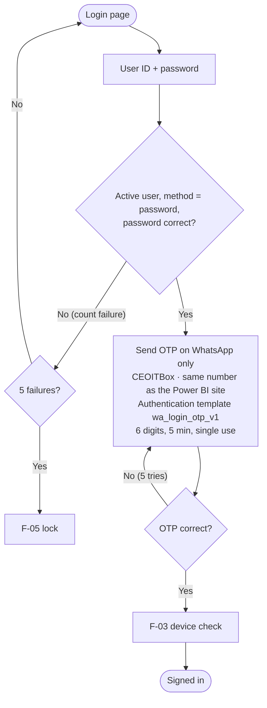
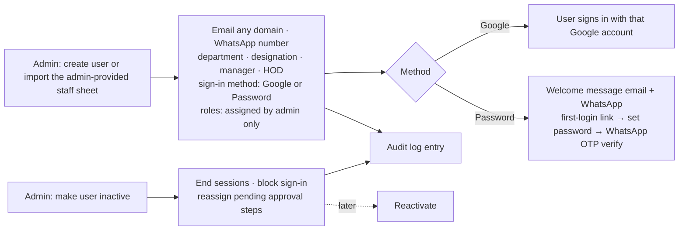
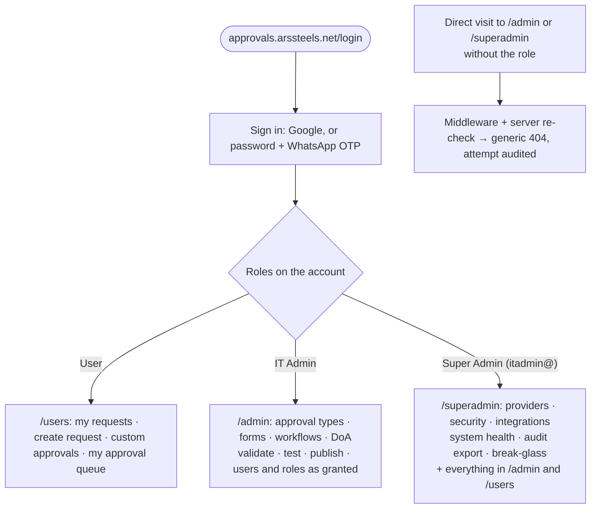
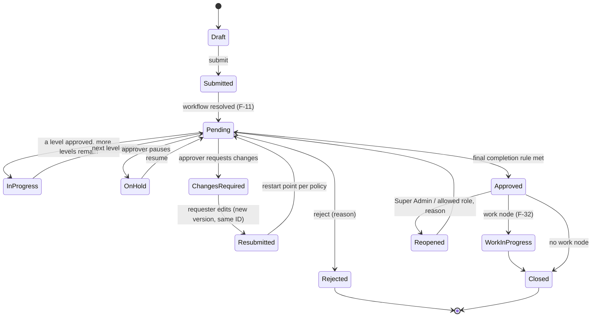
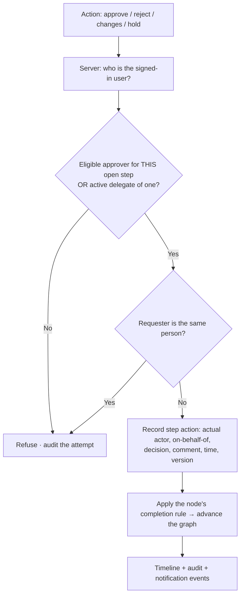
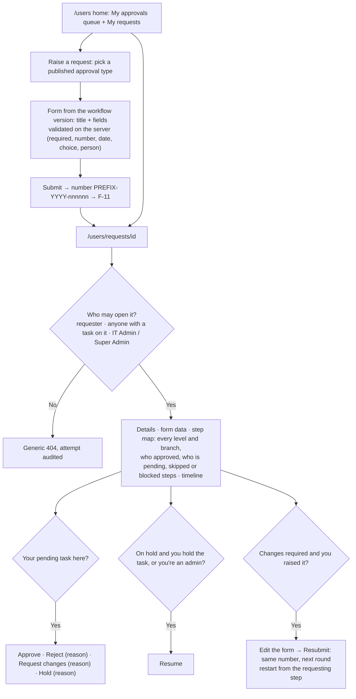
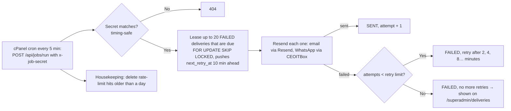
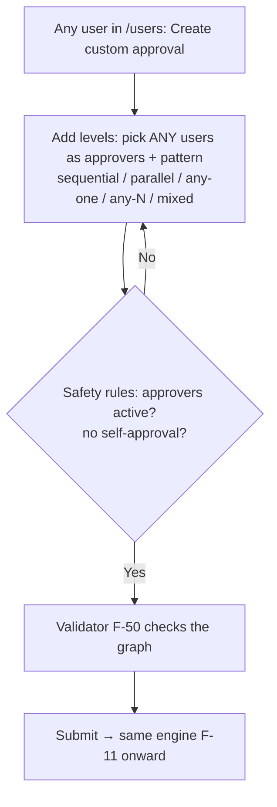
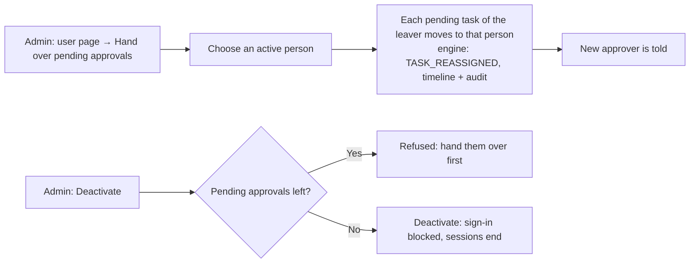
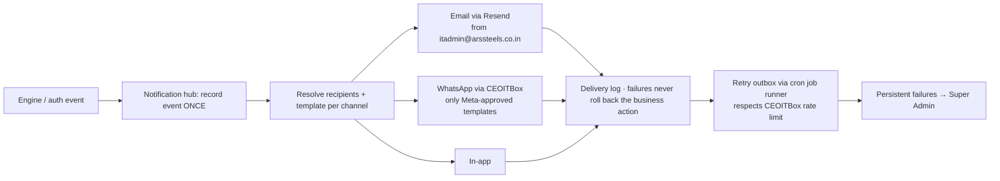

# ARS Approval Platform — Flows

> **Mandatory living file.** Every flow in the platform is recorded here: sign-in, approvals, notifications, admin work.
> - Add a flow here *before* building it (and add a checklist item in PLAN-CHECKLIST.md).
> - When a flow changes, update it here and note the date. Never delete an old flow; mark it `Superseded (date) by F-xx`.
> - Part A holds the Asana flows as **reference only** (D-013: no import). Part B holds the new platform flows.
> - Diagrams use Mermaid (renders in VS Code, GitHub and the artifact pages).

## ★ North star
**Multi-level approvals in any custom manner.** Every approval flow below (F-20 and later) is built from the same parts:
- node types: START, APPROVAL, PARALLEL-SPLIT, JOIN, CONDITION, WORK, END
- completion rules: ALL / ANY_ONE / ANY_N_OF_M
- approver sources: user, role, HOD, manager, group, form field

The number of levels and how they combine is unlimited. There are no fixed "Level 1–4" slots.

## Index
| ID | Flow | Status |
|---|---|---|
| A-01…A-12 | Asana reference flows | Reference |
| F-01 | Google sign-in | Built 28 Sep 2026 (live test pending Firebase Admin values) |
| F-02 | User ID + password + OTP | Built 28 Sep 2026 (live send pending the CEOITBox key) |
| F-03 | New-login detection and alert | Built 28 Sep 2026 (device cookie; location later) |
| F-04 | Set password + forgot password | Built 30 Sep 2026 (live send pending the CEOITBox key) |
| F-05 | Lockout and "This wasn't me" | Built 28 Sep 2026 (admin unlock in S2-03) |
| F-06 | User creation, roles, inactivation (Admin Portal) | Built 30 Sep 2026 (bulk import later) |
| F-07 | Break-glass access | Partly built: sign-in window + alert; enable script S2-07 |
| F-08 | Role routing: /users, /admin, /superadmin | Built 28 Sep 2026 |
| F-10 | Request state machine | Planned |
| F-11 | Submission → workflow resolution | Built with screens 30 Sep 2026 |
| F-12 | Approver action authorisation | Built and tested on MySQL 30 Sep 2026 |
| F-20 | Multi-level building blocks | Engine core built 28 Sep 2026 |
| F-21 | Sequential multi-level | Engine core built 28 Sep 2026 |
| F-22 | Parallel (ALL) | Engine core built 28 Sep 2026 (joins ALL / ANY_ONE / ANY_N) |
| F-23 | Any-one / Any-N-of-M | Engine core built 28 Sep 2026 |
| F-24 | Conditional / DoA routing | Engine core built 28 Sep 2026 (DoA values: Q-004) |
| F-25 | Hybrid (combined) | Engine core built 28 Sep 2026 |
| F-26 | Changes required → resubmission | Built with screens 30 Sep 2026 |
| F-27 | On Hold / resume | Built with screens 30 Sep 2026 |
| F-28 | Reject | Built with screens 30 Sep 2026 |
| F-29 | Reopen | Planned |
| F-30 | Delegation | Built and verified 1 Oct 2026 |
| F-31 | SLA, reminder, escalation | Built 1 Oct 2026 (calendar hours; holidays in S5) |
| F-32 | Work assignment after approval | Planned |
| F-33 | Employee custom approval | Built and verified 1 Oct 2026 |
| F-40 | Notification pipeline | Planned |
| F-50 | Workflow authoring: design → validate → test → publish → version | Levels builder built 30 Sep 2026; canvas later |
| F-51 | Admin configuration change (audited) | Built for settings, users, departments, workflows 30 Sep 2026 |
| F-52 | Provider settings and test send (Super Admin) | Built 30 Sep 2026 |
| F-53 | Break-glass console script | Built 30 Sep 2026 (Q-015 open) |
| F-13 | Request persistence and concurrency | Built and tested on MySQL 30 Sep 2026 |
| F-15 | Comments on a request | Built and verified 1 Oct 2026 |
| F-16 | Handing over pending approvals | Built and tested on MySQL 1 Oct 2026 |
| F-54 | DoA view derived from workflows | Built and verified 1 Oct 2026 |
| F-90 | GoDaddy deployment and go-live | Guide + privilege check ready 1 Oct 2026; deploy on owner's go-ahead |
| F-14 | Request screens: raise → queue → act → resubmit | Built and verified in the browser 30 Sep 2026 |
| F-41 | Retry runner for failed messages | Built 30 Sep 2026 (cron set up at go-live) |
| F-09 | Rate limiting on sign-in and codes | Built and verified 30 Sep 2026 |
| F-60…F-71 | First templates mapped from Asana | Planned |

---

# Part A — Asana reference flows (as found 24–25 Sep 2026)

Full detail: `reference/asana-approval-audit.html` and `reference/asana-rules-notes.md`.

| ID | Asana system | Flow as it runs | Defects to avoid (guardrails) |
|---|---|---|---|
| A-01 | Tier template (ED, Finance, Valarmadhi, SCM, Sumit) | Form → master "Form Submission" → built-in approval by one approver → Approved / Rejected / Hold (Hold marked complete) → copied into the department project by rule | Hold = complete (G-03); department copies (G-05); duplicate comments (G-06); no amount routing (G-07); CA/NBD not routed (G-11) |
| A-02 | MD | Form → Approval ARS = Submitted → MD sets Approved / Reviewed / Hold / Request Changes / Rejected → Resubmission loop (Resubmitted → back to Form Submission, due +1 day) | Rejected → Approved Section (G-02); copies mark any completion Approved (G-02); shared MD account (G-12) |
| A-03 | ED | As A-01, approver Rajesh Bhatia; the dropdown does nothing | Stuck when only the dropdown is set (G-02) |
| A-04 | Finance + Valarmadhi | Two parallel single-approver tiers; F&A re-files between them after a rejection | Split history (G-04); anyone can change the approval status (G-01) |
| A-05 | SCM | Single approver madhanagopal (86% POs) | No amount limit (G-07) |
| A-06 | Sumit | Single approver; only NBD uses it; routing never ran | NBD not routed (G-11) |
| A-07 | Legacy HR tier | Dropdown-driven, dormant | Unused structures (G-15) |
| A-08 | HR / Admin / Recruitment | Manager → HOD (Srinivasa Raghavan K / Gokulakrishnan → Subashini); rules reopen the task and reassign it to the HOD | Checks the assignee, not the actor (G-01); Recruitment has no check |
| A-09 | Finance Internal | Level 1 by Nature (6 checkers) → optional level 2 (Naveen / Anbu) → HOD Valarmadhi | No reject/hold at level 2 (G-10) |
| A-10 | IT Internal | HOD (Babulal) → Approved; intended "Assigned To → Task Completed" never runs | Misrouted work hand-off (→ F-32) |
| A-11 | Price Realisation | Parallel HOD approval subtasks → ED → MD; stalled at ED | "AI decides approver count" (G-13); approve vs acknowledge undecided |
| A-12 | ASP / Plant / Branding / Training / IT Head | Manager → HOD templates, unused | Plant HOD check wrong (G-09); Branding impossible routing (G-08) |

---

# Part B — New platform flows

## F-01 Google sign-in (no OTP, D-006)

- Any email domain is allowed (D-004). Pattern taken from the Power BI site (`server/auth/google-login.ts`). *Updated 28 Sep 2026.*

## F-02 User ID + password + OTP

- First sign-in: set a password (asset-pack screens), then verify the WhatsApp number by OTP.
- OTP on WhatsApp only (D-025). Every response is identical whether or not the account exists (anti-enumeration). *Updated 28 Sep 2026.*
- **As built (28 Sep 2026), all values configurable in `/superadmin`:**
  - An unknown user ID still runs a dummy password check, so the timing reveals nothing.
  - An inactive account, a Google-only account or a disabled break-glass account gets the same generic "user ID or password is incorrect".
  - A locked account is refused even with the right password.
  - Codes: 6 digits, 5 minutes, stored hashed, single use. There is a 30 s cooldown between codes and a cap of 5 per hour. 5 wrong codes end the challenge; a right code after that is still refused.
  - Resend works only on an open challenge and closes the old code.
  - After the code is accepted, the account is checked again, in case it was deactivated or locked in the meantime.
  - If the OTP template is inactive or the WhatsApp send fails, the user sees "couldn't send the code" and an `OTP_DELIVERY_FAILED` audit entry is written. The sign-in cannot continue without the code; only *notifications* are fire-and-forget.

## F-03 New-login detection and alert

- **As built (28 Sep 2026):**
  - The device is recognised by a signed `ars_device` cookie; a forged cookie counts as a new device. Browser/OS and location matching come later (P1-17).
  - The very first sign-in on a new account is not alerted.
  - The alert is sent after the sign-in response is decided. A failed alert never blocks the sign-in.
  - Every Super Admin sign-in (N-04) and every break-glass sign-in (N-05) also alerts all Super Admins.
  - The "This wasn't me" link is a signed, single-purpose token valid for 7 days.

## F-04 Forgot password
User ID → OTP on WhatsApp → set new password → all sessions end → alert on email + WhatsApp. *Updated 28 Sep 2026 (D-025).*

**Design for S2-04 (28 Sep 2026):**
```mermaid
flowchart TD
  subgraph SP["Set password: first sign-in, P1-13"]
    A1[Admin: send set-password link] --> A2[Single-use token stored hashed
valid 72 h, emailed to the user]
    A2 --> A3[User opens /set-password?token=…
GET only shows the form; the link is never consumed by a preview]
    A3 --> A4[New password twice → policy check]
    A4 --> A5[WhatsApp OTP to the number on file
proves the number (VERIFY_WHATSAPP)]
    A5 --> A6[Code OK → save hash · token used · failures cleared
sessions ended · alert sent]
  end
  subgraph FP["Forgot password, P1-14"]
    B1["/forgot-password: User ID"] --> B2{Active password user
with WhatsApp, not security-locked?}
    B2 -- No --> B3[Same screen as yes: 'If the account exists, a code was sent'
fake challenge, no message]
    B2 -- Yes --> B4["OTP on WhatsApp: PASSWORD_RESET"]
    B4 --> B5[Code + new password twice]
    B5 --> A6
  end
```
- An account locked by "This wasn't me" can't reset its own password; only an admin unlock clears it. A reset clears a wrong-password lock.
- The same OTP limits as sign-in apply (cooldown, per-hour cap, attempts), counted per purpose.

## F-09 Rate limiting (S3-08, P1-21, D-059)
Counted in MySQL (a hit table with a sliding window), per IP address and per User ID, independent of whether the account exists:

| Action | Per IP | Per User ID |
|---|---|---|
| Password sign-in (step 1) | 20 / 15 min | 10 / 15 min |
| Code check (sign-in, set / forgot password) | 30 / 15 min | (the challenge already allows only 5 tries) |
| Forgot password (step 1) | 10 / 15 min | 5 / hour |
| Set password (step 1) | 10 / 15 min | (the link is single-use) |
| Google sign-in | 30 / 15 min | (not applicable) |

- Over the limit → HTTP 429 with a generic "Too many attempts. Try again in a few minutes." and a Retry-After header. Nothing reveals whether the User ID exists.
- The retry runner (F-41) deletes hits older than a day.

## F-05 Lockout and "This wasn't me"
- **Lockout:** 5 wrong passwords → locked 15 min (configurable) → alert to the user. Repeated locks also alert the Super Admin.
- **"This wasn't me":** end all sessions → lock the account → notify the Super Admin → the Super Admin unlocks after checking and resets the password or OTP numbers.
- **As built (28 Sep 2026):**
  - The lock happens on exactly the 5th wrong password (D-044). An `ACCOUNT_LOCKED` audit entry is written and the user is alerted.
  - "This wasn't me" ends every session and locks the account until an admin unlocks it. It writes a `NOT_ME_REPORTED` audit entry, sends "account secured" to the user, and sends a security alert to every Super Admin.

## F-06 User creation, roles, inactivation (Admin Portal only, D-033)

- Users are never hard-deleted, so history and audit stay intact. *Updated 28 Sep 2026.*

**Rules for S2-03 (D-047, 28 Sep 2026):**
- IT Admin and Super Admin can manage users.
- Only the Super Admin can grant or remove SUPER_ADMIN, or change a Super Admin or the break-glass account.
- Nobody can deactivate themselves or remove their own admin role.
- The last active Super Admin can never be deactivated or demoted.
- Other actions:
  - **Deactivate:** ends every session at once. Reassigning pending steps comes when requests exist.
  - **Unlock:** clears both wrong-password locks and security locks.
  - **Force sign-out:** ends every session.
  - **Changing the email of a linked Google account:** unlinks it, so the new Google account links on its next sign-in.
  - **Changing to Google sign-in:** removes the password.
  - **Changing to password sign-in:** the user needs a set-password link.
- Changes to the WhatsApp number or sign-in method alert the user (N-03).
- Every change writes an audit entry with before and after values; the password hash is never included.

## F-08 Role routing in the single app (D-034, D-039)

- Everyone lands on `/users`. Admins also see a switcher to their admin area.
- **As built (28 Sep 2026):**
  - With no session, or an invalid or forged one, every area redirects to `/login?next=…`.
  - A signed-in user without the role gets a generic 404, and the attempt is audited.
  - The check runs in the middleware, in every layout **and** every page (the App Router can render a page without its layout), and in every API route.
- Protection is enforced on the server in 3 layers: middleware, then every page/handler/action, then record scope. It is never enforced by hiding links alone. *Superseded 28 Sep 2026: the earlier separate admin.arssteels.net portal version of this flow.*

## F-07 Break-glass access (D-011, D-041)
Sealed recovery credentials held offline by itadmin@ → server-side script run from the GoDaddy console enables the account for a limited time → every sign-in or action alerts the Super Admin and the holder → the account auto-disables when the window ends.

## F-10 Request state machine (D-017)

- On Hold and Changes Required are **never** complete (G-03). Rejected can never be shown as Approved (G-02).

## F-11 Submission → workflow resolution
1. The requester chooses an approval type (a published template) or a custom approval (F-33).
2. The form is validated against the template's **form version**.
3. The request gets a permanent ID (e.g. `PUR-2026-000421`), version 1.
4. It binds to the **published workflow version** at submission time. Later edits to the workflow never affect it.
5. The engine walks the graph from START:
   - evaluates CONDITION nodes against the form data and the DoA matrix;
   - opens the first reachable APPROVAL node(s);
   - resolves the approvers for those nodes now, and records them.
6. It emits the events: submitted (to the requester) and action needed (to the approvers).

## F-12 Approver action authorisation (D-020)


## F-13 Request persistence and concurrency (S2-06, D-050)
```mermaid
flowchart TD
  A[Action arrives] --> T[DB transaction]
  T --> L[Lock the request's state row
SELECT … FOR UPDATE]
  L --> D[Build the directory snapshot
active users · managers · HODs · roles · groups]
  D --> E[Pure engine call
start / decide / hold / resume / resubmit]
  E --> W[Write the new state JSON (version + 1)
sync the task table for queues
append events to the timeline (append-only)]
  W --> C[Commit]
  C --> N[Notifications after commit, never inside the transaction]
```
- The request is bound to the **published workflow version** it was submitted against.
- The request number is `PREFIX-YYYY-000001`, from a locked sequence row per prefix and year.
- If two approvers act at the same moment, the row lock makes them run one after the other. The second sees the updated state, and gets a clear error if its task is closed.
- **As built (30 Sep 2026):**
  - Notifications after the commit:
    - approval needed → each new approver;
    - approved, rejected (with reason), changes requested and on hold → the requester;
    - blocked (no eligible approver, or no matching path) → every IT Admin.
  - Email and in-app work now; WhatsApp waits for the owner's templates (Q-013).
  - Only the requester can resubmit, on the same number, in the next round, optionally with new form data.

## F-14 Request screens (S3-01 to S3-04, D-055, D-057)

- Every button calls a Server Action that re-checks everything on the server (F-12). The screen only hides buttons for convenience.
- **The form belongs to the workflow version (D-055)**, so a running request keeps the fields it was raised with.
- **As built (30 Sep 2026):**
  - Title and field errors come back together.
  - After a resubmission, a level finished in an earlier round still shows who approved it.
  - The timeline hides bookkeeping events and says each thing once.
  - Rejecting or asking for changes needs a reason; hold takes an optional one.

## F-41 Retry runner (S3-07, P1-48, D-058)

- The Super Admin can press **Retry now** on a failed delivery, which makes it due immediately.

## F-20 Multi-level building blocks (north star)
| Part | Options |
|---|---|
| Node types | START · APPROVAL · PARALLEL-SPLIT · JOIN · CONDITION · WORK · NOTIFY · END |
| Completion rule (group) | ALL · ANY_ONE · ANY_N_OF_M (N set per node) · optional mandatory member |
| Approver source | Specific user · Role · Requester's HOD · Department HOD · Reporting manager · Manager's manager · Department · Approval group · Requester-selected (within governance) · User from a form field |
| Per-node settings | Allowed actions · SLA · reminder · escalation · skip rule · notification overrides |
| Level count | Unlimited; levels combine freely |

- **As built (28 Sep 2026)** in `server/engine`: the graph is START → (APPROVAL | SPLIT → … → JOIN | CONDITION)* → END.
  - Each APPROVAL step has approver sources and a completion rule (ALL, ANY_ONE, ANY_N). A JOIN has its own rule over its branches.
  - When a step starts, approvers are resolved: inactive users are dropped, duplicates are removed, and the requester is never their own approver.
  - A step with no eligible approver is **BLOCKED**, never silently approved, unless the step is set to SKIP.
  - `skipIf` skips a step when its condition matches.
  - Only the task's approver or their delegate can decide. The delegate is recorded as the actor, with on-behalf-of.
  - An ALL step rejects on the first rejection. An ANY step rejects only when its rule can no longer be met.
  - Test mode (`simulate`) runs the flow with sample values and lists the stages, with parallel steps together.

## F-21 Sequential multi-level


## F-22 Parallel (ALL must approve)


## F-23 Any-one / Any-N-of-M

- When the rule is met, the remaining open members of the group are closed as "not required" and told so.

## F-24 Conditional / DoA routing

- Conditions can use any form field (type, department, priority, amount) with AND/OR. The validator rejects impossible or conflicting conditions (G-08). The bands are placeholders until the DoA is signed off (Q-004).

## F-25 Hybrid (combined)


## F-26 Changes required → resubmission (same ID)
Approver requests changes (reason required) → state Changes Required, stays open → requester edits the form and documents → **version n+1 under the same ID** → restart point per template policy (beginning / the level that asked / a specific level) → the approvers at the restart level are notified.

- **As built (28 Sep 2026):**
  - Request changes (a reason is required) closes the open tasks, remembers which steps were open, and sets the request to CHANGES_REQUIRED.
  - Resubmit starts a new **round** on the same request. It restarts either from the beginning or from the requesting step(s), including every parallel branch that was still open.
  - Finished steps are kept.
  - Approvals from the previous round never count in the new one.
  - The full history stays on one request (G-04).

## F-27 On Hold / resume
Approver puts the request on hold (reason) → state On Hold, stays open, counts as pending, SLA paused → the approver resumes → back to Pending at the same level.

## F-28 Reject
Approver rejects (reason required) → state Rejected (final) → requester and watchers notified. A new attempt, if allowed, is a resubmission (F-26) only when the template permits "resubmit after reject". Otherwise it is a new request that links to the old one.

## F-29 Reopen
An approved request is reopened by the Super Admin or a role the Super Admin allows. A reason is required. Restart from: beginning / a chosen level / current level. A new version is created, and everything is audited.

## F-30 Delegation (D-018)
The approver (or the Super Admin) sets a date range, a delegate and a scope (all or listed types). While it is active, the delegate sees the steps and acts **on behalf of** the approver, and both are recorded. Delegation start and end notify both people.

**Design for S4-03 (D-062):**
- **Who sets it:** each person sets their own out-of-office in `/users/delegation`: a delegate, a from and to date (at most 90 days), and a reason. IT Admins can set or end one for anyone from the user page.
- **While active** (today within the dates, not ended, delegate active):
  - the delegate sees the person's pending approvals in "Waiting for me", marked "for <name>";
  - the delegate can open those requests and act; the task records the actor and "on behalf of".
- **Limits:**
  - No chains: a delegate can only act for the person who named them.
  - A delegate can never approve their own request (the engine refuses the requester as actor).
- **Alerts:** starting or ending a delegation alerts both people.

## F-31 SLA, reminder, escalation
The node starts → at the reminder time (e.g. 12 h) the approver is reminded → at the SLA (e.g. 24 h) the manager or escalation contact is notified → at the escalation time (e.g. 48 h) the request is escalated and optionally reassigned per node settings. Working days follow the holiday calendar.

**First cut for S4-04 (D-063):**
- A builder step can have "respond within N hours". Each task gets a due time when it is created.
- The job runner (F-41) checks every 5 minutes:
  - **due time reached** → a reminder to the approver (and their active delegate);
  - **twice the time** (e.g. 48 h for a 24 h limit) → an escalation notice to the approver's manager and to the IT Admins.
- Each notice is sent once per task, recorded in `task_reminders`.
- The queue shows the due time, and an "Overdue" flag once it's passed.
- Hours are calendar hours for now. Working days and the holiday calendar come later.

## F-32 Work assignment after approval
Final approval → WORK node assigns a person or department (with optional tasks) → assignee completes the tasks → requester notified → Closed. Example: IT purchase approved → IT team buys and installs → complete.

## F-33 Custom approval (any user, whenever needed, D-026)

- Predefined approvals are created only by the IT team in the Admin Portal (F-50). Custom approvals are open to everyone. *Updated 28 Sep 2026.*

**Design for S4-01 (D-060):**
- Any user opens `/users/custom` and enters:
  - a title, details, and an optional amount;
  - the levels, using the same levels editor as the IT team: any person, their own manager or HOD, a group; one step or parallel steps; all / any one / any N.
- It is submitted at once as a **CUSTOM** workflow owned by that user, with version 1 published and the request raised in one go. The number looks like `CUS-2026-000001`.
- **Checks:**
  - A step made only of the requester can't be used (no self-approval).
  - The same graph validator applies.
  - Custom approvals never appear in anyone else's "New request" list.
- Everything after submission is the normal flow (F-11 to F-14).

## F-15 Comments on a request (S4-02, D-061)
Anyone who can open the request (D-057) can post a comment of up to 2,000 characters.
- Comments are **append-only**: no edit or delete, like the rest of the history.
- They appear in a Discussion section on the request page.
- A comment notifies the requester and the people with a pending approval, except its author.
- Attachments wait for the GoDaddy disk check (Q-001).

## F-16 Handing over pending approvals (S4-05, D-064)

- The replacement can't be the requester of that request, and can't already be an approver on the same step; those tasks are listed as needing IT.
- Only pending tasks move. Decisions already taken stay with the person who took them.

## F-40 Notification pipeline

- SMS removed: OTP is WhatsApp only (D-025). *Updated 28 Sep 2026.*
- Messages carry secure deep links. Nobody approves from inside a WhatsApp chat (D-019).
- **In-app bell (S4-06):** the header shows an unread count. `/users/notifications` lists the latest 50, each opening its request, with "Mark all as read".

## F-50 Workflow authoring (IT team in `/admin`)

**Structured builder (S3-05, D-056):** a workflow is a list of **stages** run in order. A stage is either:
- **one step:** approvers from any source (people, role, requester's manager or manager's manager, requester's department HOD, a department's HOD, a group, a person chosen in a form field); needs all, any one, or any N of them; optional "skip this step when [field] [condition] [value]"; or
- **parallel steps:** two or more steps side by side, joined by all, any one, or any N of them.

The builder turns this into the engine's node graph (START → … → END; parallel stages become SPLIT → steps → JOIN). The builder's own description is saved with the version, so it can be edited again. The drag-and-drop canvas (P3-01) comes later and uses the same graph.

Before publishing:
- **Validate:** errors block publishing, warnings are shown.
- **Test mode:** enter sample form values and a sample requester, and see each stage with the names that would approve.

Publishing makes this version the one new requests use; the previous version is archived. Running requests stay on their version.

Design (drag-and-drop) → configure the nodes → **validate** (errors block publishing; warnings are shown) → **test mode** with sample values shows the exact levels and approvers → publish as version n → running requests stay on their original version → archive old versions when no longer used.

## F-54 DoA view (S4-08, D-065)
Approval limits (DoA) are expressed in the workflow itself: each amount-dependent level has "skip this step when amount is at most ₹N".
- `/admin/doa` reads every live workflow and shows it as a matrix: amount bands in rows, the levels needed in each band.
- The owner can review the bands with IT (Q-004); changing them is a new workflow version.

## F-90 GoDaddy deployment and go-live (S4-07)
Follows the Power BI site's route (Node.JS Hosting, connected to the GitHub repo).
Full steps are in `docs/DEPLOYMENT.md`:
- environment variables;
- the MySQL setup, including the TRIGGER privilege check;
- migrations and seeds;
- the first Super Admin;
- the cron line for the job runner;
- Firebase authorised domains;
- provider keys in `/superadmin`;
- the break-glass setup;
- a post-go-live checklist.

## F-51 Admin configuration change
An admin changes a setting (no step-up OTP, D-032) → saved as a new version → audit entry with before and after values → takes effect → affected admins or users notified if relevant.

## F-52 Provider settings and test send (Super Admin only, S2-01/S2-02)
```mermaid
flowchart LR
  A["/superadmin/settings"] --> B[Grouped settings: General · Sign-in security · Email · WhatsApp]
  B --> C{Secret?}
  C -- Yes --> D[Shows only Configured / Not configured
leave blank = keep · new value replaces · Remove clears]
  C -- No --> E[Shows the value; validated within safe limits]
  D & E --> F[Save → encrypted if secret → history row
(secrets: keyed fingerprint only) → audit before/after]
  F --> G[Applies on the next request (no restart)]
  A --> T[Test send: email to my address · WhatsApp to my number]
  T --> R[Result shown to the Super Admin with the provider's error code
audit entry]
```

## F-53 Break-glass console script (S2-07, D-011)
Run in the GoDaddy console only: `node scripts/admin/break-glass.js status | create | set-password | enable --minutes N | disable`.
- `create` makes the sealed account: password sign-in, all roles, `is_break_glass`, disabled.
- `enable` opens a window of at most 240 minutes; `disable` closes it at once.
- Every command writes an audit entry (source: console).
- Signing in still needs the WhatsApp OTP (see Q-015), and every sign-in alerts the Super Admins (N-05).

---

## First templates (from Asana reference, corrected)
| ID | Template | Graph | Replaces |
|---|---|---|---|
| F-60 | MD Approval | START → MD → END; resubmission allowed; later DoA-driven | A-02 (+ all MD department copies) |
| F-61 | ED Approval | START → ED (Rajesh Bhatia) → END | A-03 |
| F-62 | Finance Approval | START → Finance (Prabu) → END | A-04 |
| F-63 | Finance Approval – Valarmadhi | START → Finance (Valarmadhi) → END; or merge into F-62 as ANY_ONE (decide with Finance) | A-04 |
| F-64 | Purchase & SCM Approval | START → SCM (madhanagopal) → END; later + DoA bands | A-05 |
| F-65 | Sumit Approval | START → Sumit Bhatia → END (NBD included) | A-06 |
| F-66 | HR / Admin Approval | START → Manager (Srinivasa Raghavan K) → HOD (Subashini) → END | A-08 |
| F-67 | Recruitment Approval | START → Manager (Gokulakrishnan Raghavan) → HOD (Subashini) → END | A-08 |
| F-68 | Finance Internal | START → CONDITION(Nature) → L1 checker → CONDITION(Nature needs L2?) → L2 (Naveen / Anbu) → HOD (Valarmadhi) → END; reject/hold at every level | A-09 |
| F-69 | IT Internal | START → IT Head → WORK (Assigned To) → END | A-10 |
| F-70 | Price Realisation | START → PARALLEL(ALL: Ragu, G Chandra Mouli, Gopi K, Prabu) → ED → MD → END (approve vs acknowledge: decide) | A-11 |
| F-71 | ASP / Plant / Branding / Training | Manager → HOD with corrected routing | A-12 |
