# ARS Approval Platform — Flows

> **Mandatory living file.** Every flow in the platform is recorded here: sign-in, approvals, notifications, admin work.
> - Add a flow here *before* building it (and add a checklist item in PLAN-CHECKLIST.md).
> - When a flow changes, update it here and note the date. Never delete an old flow; mark it `Superseded (date) by F-xx`.
> - Part A holds the Asana flows as **reference only** (D-013: no import). Part B holds the new platform flows.
> - Diagrams use Mermaid (renders in VS Code, GitHub and the artifact pages).

## ★ North star
**Multi-level approvals in any custom manner.** Every approval flow below (F-20 and later) is built from the same parts:
- node types: START, APPROVAL, PARALLEL-SPLIT, JOIN, CONDITION, WORK, END
- completion rules: ALL / ANY_ONE / ANY_N_OF_M
- approver sources: user, role, HOD, manager, group, form field

The number of levels and how they combine is unlimited. There are no fixed "Level 1–4" slots.

## Index
| ID | Flow | Status |
|---|---|---|
| A-01…A-12 | Asana reference flows | Reference |
| F-01 | Google sign-in | Planned |
| F-02 | User ID + password + OTP | Planned |
| F-03 | New-login detection and alert | Planned |
| F-04 | Forgot password | Planned |
| F-05 | Lockout and "This wasn't me" | Planned |
| F-06 | User creation (Admin Portal) | Planned |
| F-07 | Break-glass access | Planned |
| F-08 | Role routing: /users, /admin, /superadmin | Planned |
| F-10 | Request state machine | Planned |
| F-11 | Submission → workflow resolution | Planned |
| F-12 | Approver action authorisation | Planned |
| F-20 | Multi-level building blocks | Planned |
| F-21 | Sequential multi-level | Planned |
| F-22 | Parallel (ALL) | Planned |
| F-23 | Any-one / Any-N-of-M | Planned |
| F-24 | Conditional / DoA routing | Planned |
| F-25 | Hybrid (combined) | Planned |
| F-26 | Changes required → resubmission | Planned |
| F-27 | On Hold / resume | Planned |
| F-28 | Reject | Planned |
| F-29 | Reopen | Planned |
| F-30 | Delegation | Planned |
| F-31 | SLA, reminder, escalation | Planned |
| F-32 | Work assignment after approval | Planned |
| F-33 | Employee custom approval | Planned |
| F-40 | Notification pipeline | Planned |
| F-50 | Workflow authoring: design → validate → test → publish → version | Planned |
| F-51 | Admin configuration change (audited) | Planned |
| F-60…F-71 | First templates mapped from Asana | Planned |

---

# Part A — Asana reference flows (as found 24–25 Sep 2026)

Full detail: `reference/asana-approval-audit.html` and `reference/asana-rules-notes.md`.

| ID | Asana system | Flow as it runs | Defects to avoid (guardrails) |
|---|---|---|---|
| A-01 | Tier template (ED, Finance, Valarmadhi, SCM, Sumit) | Form → master "Form Submission" → built-in approval by one approver → Approved / Rejected / Hold (Hold marked complete) → copied into the department project by rule | Hold = complete (G-03); department copies (G-05); duplicate comments (G-06); no amount routing (G-07); CA/NBD not routed (G-11) |
| A-02 | MD | Form → Approval ARS = Submitted → MD sets Approved / Reviewed / Hold / Request Changes / Rejected → Resubmission loop (Resubmitted → back to Form Submission, due +1 day) | Rejected → Approved Section (G-02); copies mark any completion Approved (G-02); shared MD account (G-12) |
| A-03 | ED | As A-01, approver Rajesh Bhatia; the dropdown does nothing | Stuck when only the dropdown is set (G-02) |
| A-04 | Finance + Valarmadhi | Two parallel single-approver tiers; F&A re-files between them after a rejection | Split history (G-04); anyone can change the approval status (G-01) |
| A-05 | SCM | Single approver madhanagopal (86% POs) | No amount limit (G-07) |
| A-06 | Sumit | Single approver; only NBD uses it; routing never ran | NBD not routed (G-11) |
| A-07 | Legacy HR tier | Dropdown-driven, dormant | Unused structures (G-15) |
| A-08 | HR / Admin / Recruitment | Manager → HOD (Srinivasa Raghavan K / Gokulakrishnan → Subashini); rules reopen the task and reassign it to the HOD | Checks the assignee, not the actor (G-01); Recruitment has no check |
| A-09 | Finance Internal | Level 1 by Nature (6 checkers) → optional level 2 (Naveen / Anbu) → HOD Valarmadhi | No reject/hold at level 2 (G-10) |
| A-10 | IT Internal | HOD (Babulal) → Approved; intended "Assigned To → Task Completed" never runs | Misrouted work hand-off (→ F-32) |
| A-11 | Price Realisation | Parallel HOD approval subtasks → ED → MD; stalled at ED | "AI decides approver count" (G-13); approve vs acknowledge undecided |
| A-12 | ASP / Plant / Branding / Training / IT Head | Manager → HOD templates, unused | Plant HOD check wrong (G-09); Branding impossible routing (G-08) |

---

# Part B — New platform flows

## F-01 Google sign-in (no OTP, D-006)
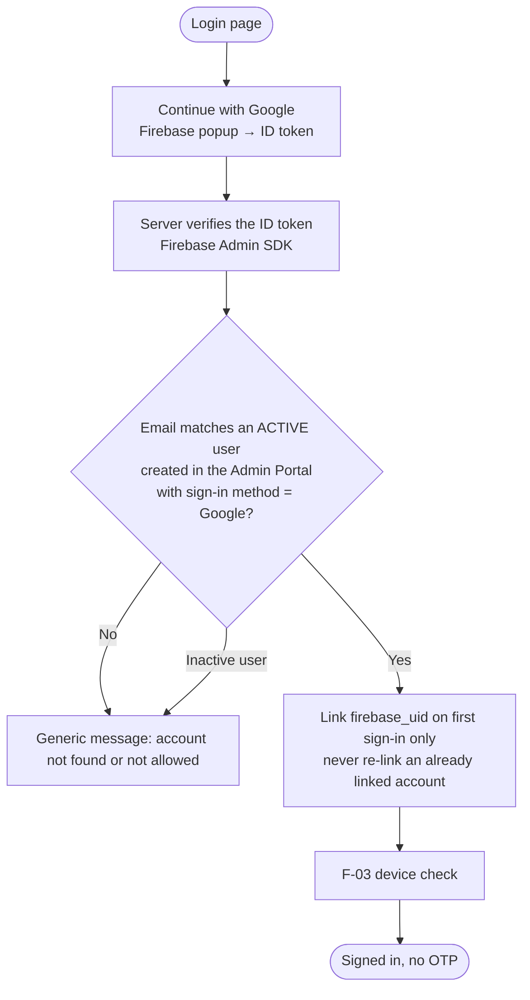
- Any email domain is allowed (D-004). Pattern taken from the Power BI site (`server/auth/google-login.ts`). *Updated 28 Sep 2026.*

## F-02 User ID + password + OTP

- First sign-in: set a password (asset-pack screens), then verify the WhatsApp number by OTP.
- OTP on WhatsApp only (D-025). Every response is identical whether or not the account exists (anti-enumeration). A failed WhatsApp send is logged but never breaks the request. *Updated 28 Sep 2026.*

## F-03 New-login detection and alert
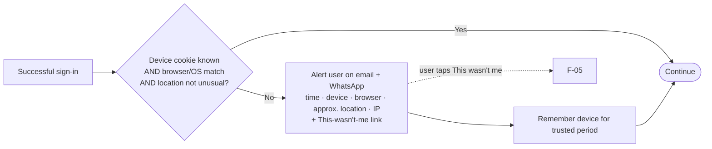

## F-04 Forgot password
User ID → OTP on WhatsApp → set new password → all sessions end → alert on email + WhatsApp. *Updated 28 Sep 2026 (D-025).*

## F-05 Lockout and "This wasn't me"
- **Lockout:** 5 wrong passwords → locked 15 min (configurable) → alert to the user. Repeated locks also alert the Super Admin.
- **"This wasn't me":** end all sessions → lock the account → notify the Super Admin → the Super Admin unlocks after checking and resets the password or OTP numbers.

## F-06 User creation, roles, inactivation (Admin Portal only, D-033)
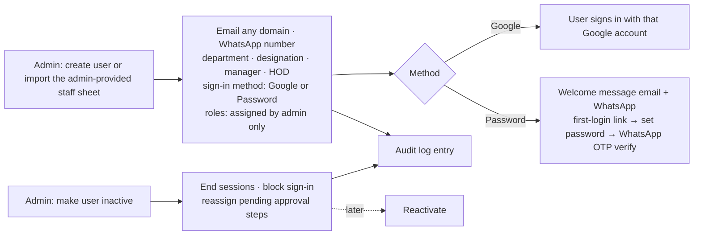
- Users are never hard-deleted, so history and audit stay intact. *Updated 28 Sep 2026.*

## F-08 Role routing in the single app (D-034, D-039)

- Everyone lands on `/users`. Admins also see a switcher to their admin area.
- Protection is enforced on the server in 3 layers: middleware, then every page/handler/action, then record scope. It is never enforced by hiding links alone. *Superseded 28 Sep 2026: the earlier separate admin.arssteels.net portal version of this flow.*

## F-07 Break-glass access (D-011, D-041)
Sealed recovery credentials held offline by itadmin@ → server-side script run from the GoDaddy console enables the account for a limited time → every sign-in or action alerts the Super Admin and the holder → the account auto-disables when the window ends.

## F-10 Request state machine (D-017)
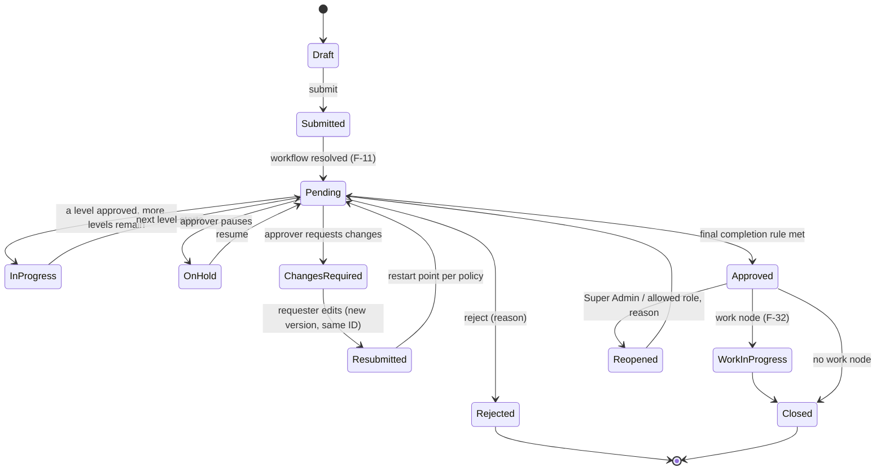
- On Hold and Changes Required are **never** complete (G-03). Rejected can never be shown as Approved (G-02).

## F-11 Submission → workflow resolution
1. The requester chooses an approval type (a published template) or a custom approval (F-33).
2. The form is validated against the template's **form version**.
3. The request gets a permanent ID (e.g. `PUR-2026-000421`), version 1.
4. It binds to the **published workflow version** at submission time. Later edits to the workflow never affect it.
5. The engine walks the graph from START:
   - evaluates CONDITION nodes against the form data and the DoA matrix;
   - opens the first reachable APPROVAL node(s);
   - resolves the approvers for those nodes now, and records them.
6. It emits the events: submitted (to the requester) and action needed (to the approvers).

## F-12 Approver action authorisation (D-020)
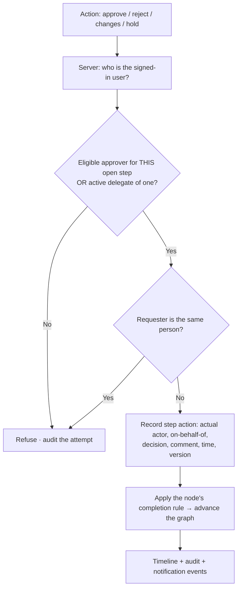

## F-20 Multi-level building blocks (north star)
| Part | Options |
|---|---|
| Node types | START · APPROVAL · PARALLEL-SPLIT · JOIN · CONDITION · WORK · NOTIFY · END |
| Completion rule (group) | ALL · ANY_ONE · ANY_N_OF_M (N set per node) · optional mandatory member |
| Approver source | Specific user · Role · Requester's HOD · Department HOD · Reporting manager · Manager's manager · Department · Approval group · Requester-selected (within governance) · User from a form field |
| Per-node settings | Allowed actions · SLA · reminder · escalation · skip rule · notification overrides |
| Level count | Unlimited; levels combine freely |

## F-21 Sequential multi-level
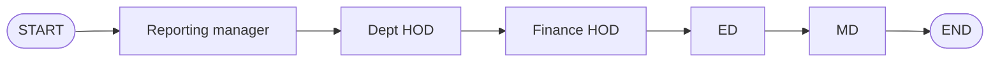

## F-22 Parallel (ALL must approve)
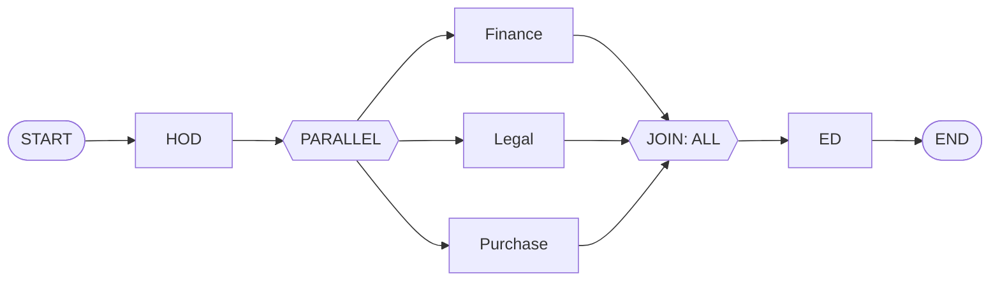

## F-23 Any-one / Any-N-of-M

- When the rule is met, the remaining open members of the group are closed as "not required" and told so.

## F-24 Conditional / DoA routing
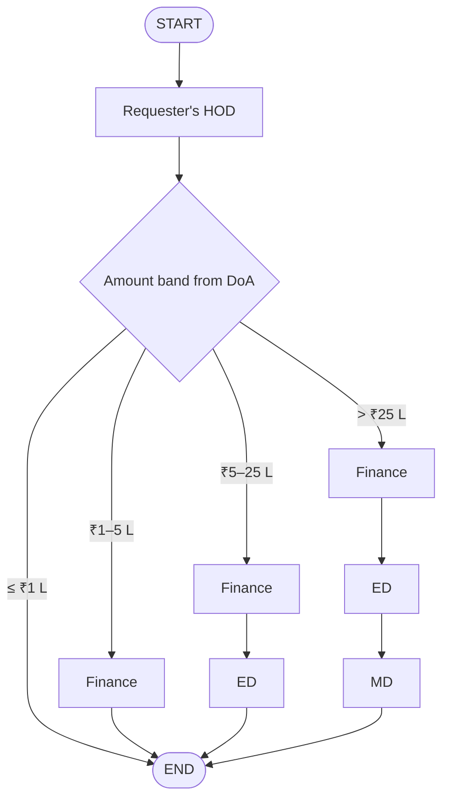
- Conditions can use any form field (type, department, priority, amount) with AND/OR. The validator rejects impossible or conflicting conditions (G-08). The bands are placeholders until the DoA is signed off (Q-004).

## F-25 Hybrid (combined)
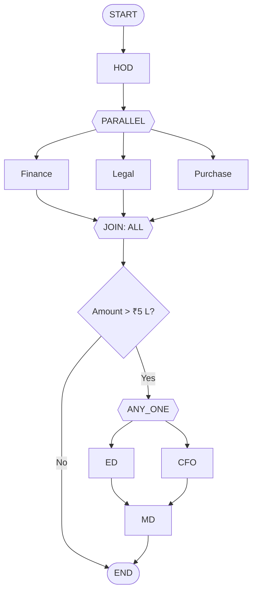

## F-26 Changes required → resubmission (same ID)
Approver requests changes (reason required) → state Changes Required, stays open → requester edits the form and documents → **version n+1 under the same ID** → restart point per template policy (beginning / the level that asked / a specific level) → the approvers at the restart level are notified.

## F-27 On Hold / resume
Approver puts the request on hold (reason) → state On Hold, stays open, counts as pending, SLA paused → the approver resumes → back to Pending at the same level.

## F-28 Reject
Approver rejects (reason required) → state Rejected (final) → requester and watchers notified. A new attempt, if allowed, is a resubmission (F-26) only when the template permits "resubmit after reject". Otherwise it is a new request that links to the old one.

## F-29 Reopen
An approved request is reopened by the Super Admin or a role the Super Admin allows. A reason is required. Restart from: beginning / a chosen level / current level. A new version is created, and everything is audited.

## F-30 Delegation (D-018)
The approver (or the Super Admin) sets a date range, a delegate and a scope (all or listed types). While it is active, the delegate sees the steps and acts **on behalf of** the approver, and both are recorded. Delegation start and end notify both people.

## F-31 SLA, reminder, escalation
The node starts → at the reminder time (e.g. 12 h) the approver is reminded → at the SLA (e.g. 24 h) the manager or escalation contact is notified → at the escalation time (e.g. 48 h) the request is escalated and optionally reassigned per node settings. Working days follow the holiday calendar.

## F-32 Work assignment after approval
Final approval → WORK node assigns a person or department (with optional tasks) → assignee completes the tasks → requester notified → Closed. Example: IT purchase approved → IT team buys and installs → complete.

## F-33 Custom approval (any user, whenever needed, D-026)
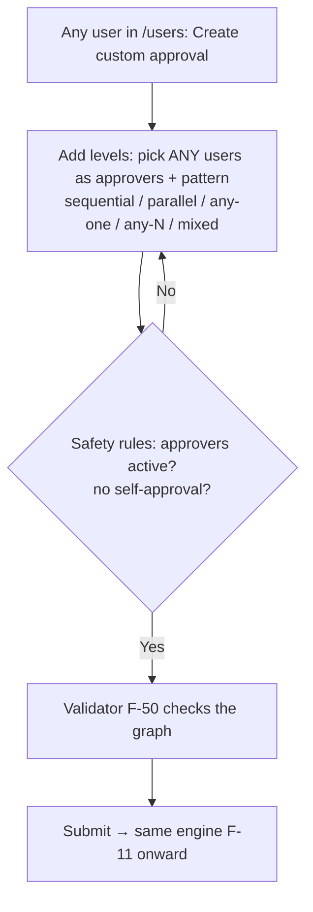
- Predefined approvals are created only by the IT team in the Admin Portal (F-50). Custom approvals are open to everyone. *Updated 28 Sep 2026.*

## F-40 Notification pipeline
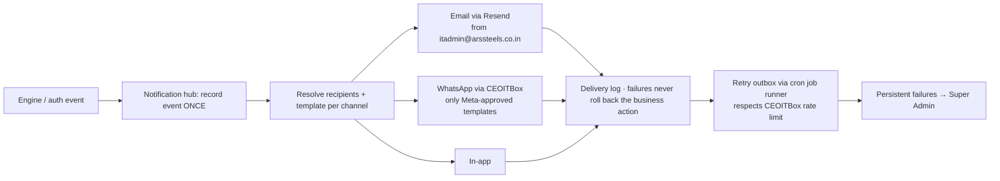
- SMS removed: OTP is WhatsApp only (D-025). *Updated 28 Sep 2026.*
- Messages carry secure deep links. Nobody approves from inside a WhatsApp chat (D-019).

## F-50 Workflow authoring (IT team in `/admin`)
Design (drag-and-drop) → configure the nodes → **validate** (errors block publishing; warnings are shown) → **test mode** with sample values shows the exact levels and approvers → publish as version n → running requests stay on their original version → archive old versions when no longer used.

## F-51 Admin configuration change
An admin changes a setting (no step-up OTP, D-032) → saved as a new version → audit entry with before and after values → takes effect → affected admins or users notified if relevant.

---

## First templates (from Asana reference, corrected)
| ID | Template | Graph | Replaces |
|---|---|---|---|
| F-60 | MD Approval | START → MD → END; resubmission allowed; later DoA-driven | A-02 (+ all MD department copies) |
| F-61 | ED Approval | START → ED (Rajesh Bhatia) → END | A-03 |
| F-62 | Finance Approval | START → Finance (Prabu) → END | A-04 |
| F-63 | Finance Approval – Valarmadhi | START → Finance (Valarmadhi) → END; or merge into F-62 as ANY_ONE (decide with Finance) | A-04 |
| F-64 | Purchase & SCM Approval | START → SCM (madhanagopal) → END; later + DoA bands | A-05 |
| F-65 | Sumit Approval | START → Sumit Bhatia → END (NBD included) | A-06 |
| F-66 | HR / Admin Approval | START → Manager (Srinivasa Raghavan K) → HOD (Subashini) → END | A-08 |
| F-67 | Recruitment Approval | START → Manager (Gokulakrishnan Raghavan) → HOD (Subashini) → END | A-08 |
| F-68 | Finance Internal | START → CONDITION(Nature) → L1 checker → CONDITION(Nature needs L2?) → L2 (Naveen / Anbu) → HOD (Valarmadhi) → END; reject/hold at every level | A-09 |
| F-69 | IT Internal | START → IT Head → WORK (Assigned To) → END | A-10 |
| F-70 | Price Realisation | START → PARALLEL(ALL: Ragu, G Chandra Mouli, Gopi K, Prabu) → ED → MD → END (approve vs acknowledge: decide) | A-11 |
| F-71 | ASP / Plant / Branding / Training | Manager → HOD with corrected routing | A-12 |
