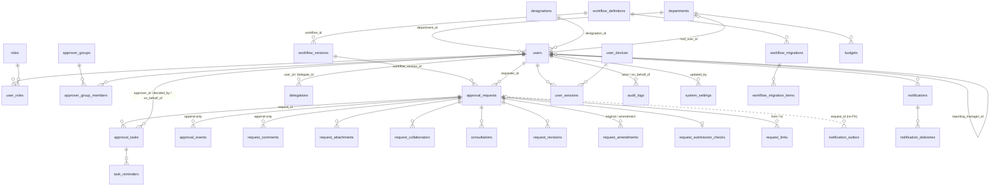

# 05 — Database audit

ARS Approval Platform v1.8.0: MySQL 8, 30 additive migrations, 64 tables. Audited 16 Oct 2026 (read-only). No connection was made to any production database.

## Lead-auditor notes

- **M-1 confirmed by the lead auditor (AUD-03).** `database/seeds/003_bootstrap_super_admin.sql:11-13` re-adds the SUPER_ADMIN, IT_ADMIN and USER roles to `itadmin` with `INSERT IGNORE` on every start. The file's own header says it "never changes an existing one", but the roles statement does.
- **T-1 confirmed in code; impact not yet known (AUD-04).**
  - `lib/db/client.ts:21-22` sets `timezone: "Z"` for the driver only, and no `SET time_zone` runs on pooled connections. The only exception is the backup stream (`server/ops/backup.ts:83`).
  - Due times written from JS (UTC) are compared with `CURRENT_TIMESTAMP` in SQL, for example `analytics.repository.ts:82` and `analytics-more.repository.ts:194`.
  - If the production MySQL runs in UTC there is no defect. Checking takes one query by the owner: `SELECT @@global.time_zone, @@session.time_zone, NOW(), UTC_TIMESTAMP();`.
- **Severity recalibration.** The database sub-audit rated these items P2: F-2, F-3, I-2, I-3, I-4, J-1 and T-4. The consolidated register in `06` treats them as **P3**, because today's volume is small (the perf doc measured 6,300 requests with a healthy p95). Revisit them when volume grows or when Phase D starts. I-1 (sargable dates), R-1 (retention), F-1 (outbox index), T-2 (drift check) and M-2/M-3 (migration checksum and lock) stay P2.
- **Integration tests passed on 16 Oct 2026.** All 188 ran against a fresh MySQL 8.0 database built by the real migrations and seeds, including the backup and restore drill. The migrations therefore apply cleanly from empty. They were not tested against the production data shape.

---

Scope: `database/migrations/*.sql` (30 files), `database/seeds/*.sql`, `scripts/database/*`, `lib/db/client.ts`, `lib/db/transaction.ts`, `lib/db/repositories/*.ts`, plus the SQL builders they import (`server/requests/list-filters.ts`, `server/approvals/queue-filters.ts`, `server/analytics/scope.ts`, `server/ops/governance.ts`).
Method: static reading only. No database was connected, nothing was run, no `.env*` file was opened. All paths below are relative to `D:\Omniroute\ARS Approval System\`.

Note on indexes: InnoDB creates an index on every foreign-key column that has none. Every `*_id` / `*_by` column with an FK is therefore indexed, even where the migration declares no index. The findings below take this into account.

---

### 1. Migration approach

| Aspect | What the code does | Evidence |
|---|---|---|
| Tracking | `schema_migrations(filename PK, applied_at)`. Pending = every `*.sql` in the folder, sorted by name, minus the applied ones. | `scripts/database/migrate.js:49-71` |
| Per-statement resume | `schema_migration_progress(filename, statements_done)` is updated after each statement. A failed file restarts at the statement that failed. | `migrate.js:58-63, 81-100` |
| Transactions | None. Each statement runs in autocommit. MySQL DDL commits implicitly anyway. MySQL 8 makes a single DDL statement atomic, so one multi-clause `ALTER TABLE` is all or nothing, but a file is not. | `migrate.js:84-98` |
| Half-applied file | Statements 1..k-1 stay applied and recorded, and the run stops with "fix the cause, then start again". This is a sound design. However, the resume works by statement index, and **nothing checksums the file**: if someone edits the failed file to fix it (adds, removes or reorders statements), the index points at a different statement (Finding M-2). | `migrate.js:81-92` |
| Statement splitting | A statement ends at a line whose trimmed text ends with `;`. `-- @begin`/`-- @end` wrap trigger bodies. The connection uses `multipleStatements: true`, so a line like `...; -- note` is not split, and two statements go to the server as one batch and count as one step. No current file does this. | `migrate.js:16-44`, `scripts/database/env.js:35` |
| Down / rollback | None. There are no down files. The comments in v1.5 to v1.8 say "Additive only, so rollback to the previous app version keeps working". That is an app rollback, not a schema rollback. | `202610100900_v150_user_comfort.sql:1-2`, `202610140900_v170.sql:1-2` |
| Concurrency | No `GET_LOCK` or advisory lock. Two processes that start together (for example a Passenger restart that overlaps with a manual `npm start`) can both apply the same file (Finding M-3). | `migrate.js` (no lock) |
| Edited old migrations | An applied file is skipped by name only. Later edits are ignored without any warning. | `migrate.js:65-71` |
| Data migrations | Several files contain DML: `UPDATE designations SET is_approver = TRUE`, the delegation back-fill, and the email fix. These are idempotent or one-shot by design. | `202610081500...sql:9`, `202610100900...sql:67-68`, `202610081400...sql:5-8` |
| Run on every start | `"start": "node scripts/database/migrate.js && node scripts/database/seed.js && next start"` | `package.json:12` |
| Seed behaviour | `seed.js` runs every `database/seeds/*.sql` on **every** start, outside any transaction. | `scripts/database/seed.js:12-27` |
| Seed 001 (roles) | Upsert. It **overwrites** `name`, `description` and `is_system` of the 4 system roles on each start, so admin edits to those rows are reverted. | `database/seeds/001_roles.sql:2-7` |
| Seed 002 (WA OTP template) | Upsert. It overwrites `provider_name` of `WA_LOGIN_OTP_V1` v1 on each start. | `002_whatsapp_otp_template.sql:4-6` |
| Seed 003 (bootstrap admin) | The user insert is a no-op if the row exists, which is correct. But `INSERT IGNORE INTO user_roles ... r.code IN ('SUPER_ADMIN','IT_ADMIN','USER') WHERE u.login_id='itadmin'` **re-grants Super Admin on every restart**. If an admin removes those roles from that account, the next deploy or restart puts them back (Finding M-1). | `003_bootstrap_super_admin.sql:9-13` |
| Pre-flight / backup tools | `check-privileges.js` checks CREATE/ALTER/TRIGGER/SKIP LOCKED/JSON on a scratch table. `verify-backup.js` restores into an empty database (and refuses `DB_NAME`), then compares row counts, the trigger count and that the append-only triggers still refuse writes. Both are sound. | `scripts/database/check-privileges.js`, `verify-backup.js:40-110` |

---

### 2. Final schema inventory (after all 30 migrations)

64 tables: 62 from migrations, plus `schema_migrations` and `schema_migration_progress`. All are InnoDB with `utf8mb4` / `utf8mb4_unicode_ci`. **No FK declares `ON DELETE` or `ON UPDATE`**, so every FK is RESTRICT/NO ACTION. "Audit cols" lists the ones present: c = created_at, u = updated_at, cb = created_by, ub = updated_by.

| Table | Purpose | PK | FKs (all RESTRICT) | Unique / key indexes | Soft-delete / lifecycle | Audit cols | JSON |
|---|---|---|---|---|---|---|---|
| departments | Org master | id | hod_user_id→users | uq code | active | c,u | – |
| designations | Org master, `is_approver` | id | – | uq code | active | c,u | – |
| users | People | id | department_id, designation_id, reporting_manager_id, created_by, updated_by → users/master | uq login_id, email, whatsapp_number, firebase_uid; idx dept, manager, active | active (never deleted), is_demo, is_break_glass | c,u,cb,ub | – |
| roles | Role catalog | id | – | uq code | active | c,u | – |
| user_roles | User↔role | (user_id, role_id) | user, role, assigned_by | PK | – (hard delete on re-assign) | assigned_at | – |
| otp_challenges | WhatsApp OTP | id | user_id | uq challenge_token_hash; idx (user_id, created_at), expires_at | consumed_at | c | – |
| user_devices | Known browsers | id | user_id | uq (user_id, device_key_hash) | trusted_until | first/last_seen | – |
| user_sessions | Server sessions | id CHAR(36) | user_id, device_id | idx (user_id, revoked_at) | revoked_at, expires_at | c | – |
| login_logs | Sign-in attempts | id | user_id (device_id and session_id have **no FK**) | idx (user_id, occurred_at) | – | occurred_at | – |
| audit_logs | Append-only audit (triggers) | id | actor_user_id, on_behalf_of_user_id | idx (actor, occurred_at), (entity_type, entity_id, occurred_at), (action, occurred_at) | append-only | occurred_at(3) | metadata_json |
| system_settings | Admin settings (encrypted values) | id | updated_by | uq setting_key | – | u, ub | value TEXT (may hold JSON) |
| settings_change_history | Settings history | id | changed_by | idx setting_key | – | changed_at | – |
| whatsapp_templates | WA templates, versioned | id | created_by, updated_by, submitted_by | uq (template_code, language, version); idx (event_type, status, approval_status) | status RETIRED | c,u,cb,ub | – |
| whatsapp_template_variables | Positional vars | id | template_id | uq (template_id, position) | – | – | – |
| whatsapp_rate_limit_log | WA send limiter | id | – | idx occurred_at | pruned to 60 s | occurred_at | – |
| notifications | In-app inbox | id | user_id | idx (user_id, read_at) | read_at | c | – |
| notification_deliveries | Per-channel delivery | id | notification_id | idx (status, next_retry_at), provider_reference | status | c | payload_json (sealed) |
| jobs | Original job queue, now only a heartbeat row | id | – | idx (status, run_after) | – | c | payload_json |
| password_tokens | Set-password links | id | user_id, created_by | uq token_hash; idx (user_id, used_at) | used_at | c, cb | – |
| approver_groups | GROUP approver source | id | created_by | uq code | active | c,u,cb | – |
| approver_group_members | Members | (group_id, user_id) | group, user, added_by | PK | hard delete | added_at | – |
| workflow_definitions | Approval types (PREDEFINED/CUSTOM) | id | owner_user_id, created_by | uq code | active | c,u,cb | settings_json |
| workflow_versions | Versioned graph and form | id | workflow_id, created_by, published_by | uq (workflow_id, version_no); uq generated `published_workflow_id` (one PUBLISHED per workflow) | status ARCHIVED | c, cb | definition_json, form_json, builder_json |
| request_sequences | Number generator | (prefix, year) | – | PK | – | – | – |
| approval_requests | Request instance | id | workflow_version_id, requester_id, deleted_by | uq request_no; uq (requester_id, submission_key); idx (requester_id, status), (status, submitted_at), deleted_at, (status, valid_until), submitted_at, closed_at | **deleted_at / deleted_by / delete_reason** | submitted_at, u | form_data_json, state_json |
| approval_tasks | Projection of `state_json.tasks` for queues | id | request_id, approver_id, decided_by, on_behalf_of | uq (request_id, task_key); idx (approver_id, status, created_at), (status, due_at), decided_at, (request_id, status) | status CANCELLED | created_at (no DEFAULT) | – |
| approval_events | Append-only timeline (triggers) | id | request_id, actor_id | idx (request_id, id) | append-only | c(3) | payload_json |
| rate_limit_hits | Auth rate limiter | id | – | idx (bucket, occurred_at), occurred_at | pruned 1 day | occurred_at | – |
| request_comments | Append-only comments (triggers) | id | request_id, author_id | idx (request_id, id) | append-only | c(3) | – |
| delegations | Out of office | id | user_id, delegate_id, created_by, ended_by | idx (user_id, ends_on), (delegate_id, ends_on) | ended_at | c, cb | – |
| task_reminders | SLA reminders sent | (task_id, kind) | task_id | PK | hard delete on handover | sent_at | – |
| holidays | Working calendar | holiday_on | created_by | PK | hard delete | c, cb | – |
| request_attachments | File metadata | id | request_id, uploaded_by | uq stored_path; idx request_id | never deleted | c(3) | – |
| notification_outbox | Transactional outbox | id | **none** (request_id has no FK and no index) | idx (sent_at, created_at) | sent_at; pruned 30 d | c(3) | payload_json |
| used_security_links | One-time link ledger | token_hash | – | idx used_at | – | used_at | – |
| request_drafts | Autosaved drafts | id | user_id | uq (user_id, draft_key); idx expires_at | expires_at; pruned | c, u (no ON UPDATE; the app sets it) | fields_json |
| saved_views | Search saved views | id | user_id | uq (user_id, name) | hard delete | c,u | query_json |
| notification_preferences | Opt-outs | (user_id, event_group, channel) | user_id | PK | – | u | – |
| user_flags | Per-user flags | (user_id, flag) | user_id | PK | – | set_at | – |
| user_settings | Per-user settings | (user_id, setting_key) | user_id | PK | – | u | – |
| recent_views | Recently viewed | (user_id, request_id) | user_id, request_id | idx (user_id, viewed_at) | pruned 90 d | viewed_at | – |
| consultations | Advice requests | id | request_id, requested_by, consultee_id | idx request_id, (consultee_id, status) | status WITHDRAWN | c | – |
| request_revisions | Per-round snapshot | (request_id, round) | request_id, created_by | PK | – | c, cb | fields_json |
| request_links | Related / follow-up | id | from, to, created_by | uq (from, to); idx to | – | c, cb | – |
| budgets | Dept budget per FY | id | department_id, updated_by | uq (department_id, fy_start_year) | – | u, ub | – |
| request_submission_checks | Submit-time checks | request_id | request_id (budget_department has **no FK**) | idx (budget_department, budget_fy) | – | c | result_json |
| request_templates | Personal templates | id | user_id, workflow_id | uq (user_id, workflow_id, name) | hard delete | c,u | fields_json |
| job_runs | Automation run history | id | – | idx (job_key, started_at), started_at | pruned 90 d | started_at | counts_json |
| stuck_snoozes | Stuck-request snooze | (request_id, reason_code) | request_id, created_by | PK | until_at | c, cb | – |
| request_amendments | Post-approval amendments | id | original_id, amendment_id, created_by | uq amendment_id; idx original_id | – | c, cb | changes_json |
| workflow_migrations | Version-migration runs | id | workflow_id, from/to version, requested_by | idx (workflow_id, created_at) | – | c | mapping_json |
| workflow_migration_items | Per-request outcome | id | migration_id, request_id | idx migration_id, request_id | – | c | – |
| analytics_views | Saved analytics filters | id | user_id | uq (user_id, target, name); idx (target, shared) | hard delete | c | query_json |
| report_schedules | Scheduled reports | id | user_id | idx (active, next_run_at) | active | c | query_json, **recipients_json (user ids)** |
| report_runs | Per-slot run | id | schedule_id | uq (schedule_id, due_at) | – | started_at | – |
| alert_rules | Metric alerts | id | user_id | idx active | active | c | – |
| alert_events | Alert firings | id | rule_id | idx (rule_id, fired_at) | – | fired_at | – |
| legal_holds | Legal holds | id | owner, created_by, released_by (scope_id is **polymorphic, no FK**) | idx (released_at, scope_type, scope_id) | released_at | c, cb | – |
| request_collaborators | Followers | (request_id, user_id) | request, user, added_by, removed_by | idx (user_id, removed_at) | removed_at | added_at | – |
| export_jobs | Background exports | id | user_id | idx (user_id, created_at), (status, created_at) | status EXPIRED | c | query_json |
| custom_approval_settings | Singleton (id 1) | id TINYINT | updated_by | – | – | u, ub | form_json, policy_json |
| page_access_rules | Page ACL | id | updated_by (scope_id is **polymorphic, no FK**) | uq (page_key, scope, scope_id); idx (scope, scope_id) | hard delete | u, ub | – |
| schema_migrations / schema_migration_progress | Migration bookkeeping | filename | – | – | – | applied_at / updated_at | – |

Triggers: `audit_logs`, `approval_events` and `request_comments` each have BEFORE UPDATE and BEFORE DELETE triggers that SIGNAL.

---

### 3. Entity relationships (core)

Summary: the request aggregate is `approval_requests`. Its JSON `state_json` is the engine's source of truth. `status` and `round` are denormalised into columns, and `approval_tasks` is a projection of `state_json.tasks`. Everything else hangs off `request_id` with RESTRICT FKs, which matches the soft-delete-only policy. Users are never deleted (they are deactivated), so the RESTRICT FKs to `users` are intentional.

---

### 4. Findings

Severity: P0 = data loss, security or production outage now; P1 = likely incorrect behaviour or security weakness; P2 = scaling, maintainability or integrity gap; P3 = hygiene.

#### Migrations and seeds

| # | Sev | Status | Finding | Evidence | Recommendation |
|---|---|---|---|---|---|
| M-1 | **P1** | Confirmed | **Seed re-grants Super Admin on every start.** `INSERT IGNORE INTO user_roles ... ('SUPER_ADMIN','IT_ADMIN','USER') WHERE login_id='itadmin'` runs on each `npm start`. Revoking that account's admin roles does not last past the next restart or deploy. If `login_id` and email are both changed later, the seed creates a fresh `itadmin` Super Admin bound to the bootstrap Google address. | `database/seeds/003_bootstrap_super_admin.sql:9-13`; `package.json:12` | Grant roles only when the user row was just inserted (for example `WHERE NOT EXISTS (SELECT 1 FROM user_roles WHERE user_id = u.id)`), or gate the whole seed behind "no SUPER_ADMIN exists". |
| M-2 | P2 | Confirmed | Resume-by-statement-index does not record a file checksum. If someone edits a half-applied file to fix it, statement indices shift and the next run skips or repeats the wrong statement. Applied files that are edited later are ignored without any warning. | `scripts/database/migrate.js:65-92` | Store a SHA-256 per file in `schema_migrations`/`schema_migration_progress`. Refuse to resume or continue when it differs, and tell the operator to add a new corrective migration instead. |
| M-3 | P2 | Potential | No migration lock. Concurrent `npm start` processes can apply the same file twice, which fails on duplicate column or table and can leave progress rows out of sync. | `migrate.js:46-101` | Wrap `main()` in `SELECT GET_LOCK('ars_migrate', 60)` / `RELEASE_LOCK`. |
| M-4 | P3 | Confirmed | Seeds 001 and 002 overwrite admin-editable fields (role name and description, the OTP template's `provider_name`) on every start. | `001_roles.sql:7`, `002_whatsapp_otp_template.sql:6` | Use `INSERT IGNORE`, or update only `is_system`. |
| M-5 | P3 | Confirmed | There is no down-migration path. The "additive only" convention covers app rollback, but a bad migration can only be reversed by restoring a backup. | migrations folder | Acceptable for this stack. Document "restore-from-backup is the rollback" and keep `verify-backup.js` in the release checklist. |
| M-6 | P3 | Confirmed | Splitter edge case: an inline trailing comment after `;`, or a `;` at the end of a line inside a string, mis-splits. Because `multipleStatements: true` is set, merged statements still execute but are tracked as one step. | `migrate.js:35`, `env.js:35` | Document the rule in the migration README, or add a lint test over `database/migrations`. |

#### Time zone and data correctness

| # | Sev | Status | Finding | Evidence | Recommendation |
|---|---|---|---|---|---|
| T-1 | **P1** | Potential (depends on the server's `time_zone`) | **The session time zone is never set.** All SQL assumes stored DATETIMEs are UTC (`DATE_ADD(col, INTERVAL 330 MINUTE)` for India dates, "occurred_at is UTC"). But `DEFAULT CURRENT_TIMESTAMP`, `CURRENT_TIMESTAMP` comparisons and `DATE_ADD(CURRENT_TIMESTAMP, ...)` use the MySQL session zone, and mysql2's `timezone: "Z"` only converts JS `Date` values. `syncTasks` writes `created_at`/`due_at`/`escalate_at` from JS Dates (UTC), which are then compared with `CURRENT_TIMESTAMP` (server local). If the GoDaddy server is not on UTC, overdue flags, SLA, reminders, India-date filters and audit export ranges are all shifted. | `lib/db/client.ts:12-22` (no `SET time_zone`); `approvals.repository.ts:426-428` vs `:535, :582`; `audit.repository.ts:132-133`; `search.repository.ts:24`; only `server/ops/backup.ts:83` sets `time_zone='+00:00'` | Set `SET time_zone = '+00:00'` on every pooled connection (`pool.on('connection', c => c.query("SET time_zone='+00:00'"))`) and in `scripts/database/env.js`. Add a health check that asserts `@@session.time_zone`. |
| T-2 | P2 | Confirmed | **Denormalised request state:** `approval_requests.status`/`round` duplicate `state_json`, and `approval_tasks` is a projection that `syncTasks` only upserts and never deletes. The existence of `server/ops/repair.ts:41` ("orphanKeys" → CANCELLED) shows that drift happens. `syncTasks` also never refreshes `node_label`/`round`/`due_at` on conflict. | `approvals.repository.ts:386-437`; `server/ops/repair.ts:41`; `server/workflows/migration.ts:117` | Keep both writes in the same transaction (already done), add a scheduled consistency check that compares `state_json->'$.status'` with `status` and pending tasks with the projection, and alert on mismatch. |
| T-3 | P2 | Confirmed | Analytics history caps raw row fetches at `LIMIT 20000` and buckets in JS. Above that, charts are silently wrong, not just slow. `loadAging` fetches every open request and every pending task with no LIMIT. | `analytics-more.repository.ts:19, 66-74`; `analytics.repository.ts:241-247` | Aggregate in SQL (`GROUP BY` bucket expression), or return a "truncated" flag to the UI. |
| T-4 | P2 | Confirmed | The WhatsApp rate limiter is DELETE → COUNT → INSERT with no lock or transaction. Concurrent senders can exceed `limitPerMinute`. | `whatsapp.repository.ts:47-56` | Insert first, then count (as `hitRateLimit` does at `jobs.repository.ts:10-16`), or use `GET_LOCK`. |
| T-5 | P3 | Confirmed | The `login_logs.auth_method` ENUM lacks `'DEMO'` while `AuthMethod` and `user_sessions` include it. This is not hit today (the demo path doesn't call `recordLogin`), but in strict mode it would fail if it ever did. | `202609281202...sql:61`; `types/auth.ts:3`; `server/demo/service.ts:190` | Add `'DEMO'` to the ENUM in a new migration. |
| T-6 | P3 | Confirmed | `insights` month grouping uses `DATE_FORMAT(submitted_at,'%Y-%m')` on UTC values, unlike the India-date convention used elsewhere. | `insights.repository.ts:66-71` | Use `DATE_ADD(submitted_at, INTERVAL 330 MINUTE)`. |

#### Integrity and FKs

| # | Sev | Status | Finding | Evidence | Recommendation |
|---|---|---|---|---|---|
| F-1 | P2 | Confirmed | `notification_outbox.request_id` has **no FK and no index**. `dropOutboxForDeletedRequests` joins on it, `releaseOutboxForResend` filters on it, and `pruneOutbox` LEFT JOINs on it, so each scans the outbox. | `202610081300_qa_fixes.sql:13-22`; `outbox.repository.ts:52-57, 61-66, 97-104` | Add `INDEX (request_id)`. An FK is optional; keep it nullable. |
| F-2 | P2 | Confirmed | Polymorphic IDs with no FK: `legal_holds.scope_id`, `page_access_rules.scope_id`, `request_submission_checks.budget_department`, `login_logs.device_id`/`session_id`, `audit_logs.session_id`, and `report_schedules.recipients_json` (user ids inside JSON). Orphans are possible, for example a hold on a non-existent request ID. | `202610121400...sql:12`; `202610150900...sql:24`; `202610110900...sql:106`; `202609281202...sql:67-69`; `202610140900...sql:15` | Validate in the service layer (state that this is intended), add an FK where the target is single (`budget_department → departments`), and consider a `report_schedule_recipients` child table. |
| F-3 | P2 | Potential | `deleteUnusedWorkflow` deletes `workflow_versions` and the definition, but `request_templates.workflow_id`, `workflow_migrations` and the version FKs are RESTRICT. A type with personal templates or migration rows raises an unhandled FK error 1451 instead of returning `false`. | `approvals.repository.ts:236-246`; `202610110900...sql:129`; `202610121200...sql:18-20` | Also check `request_templates` / `workflow_migrations` before deleting, or catch `ER_ROW_IS_REFERENCED_2`. |
| F-4 | P3 | Confirmed | `approval_tasks.created_at` has no DEFAULT, and `request_drafts.updated_at` has no `ON UPDATE`. Both rely on the app always setting them (it does today). | `202609291201...sql:112`; `202610100900...sql:15` | Add defaults for safety. |
| F-5 | P3 | Confirmed | Several FK-less audit columns lack actor tracking: no `updated_by` on `workflow_definitions`, `approval_requests`, `delegations` (only `ended_by`) or `alert_rules`. History lives in `audit_logs`, so this is acceptable. | migrations | Optional. |

#### Indexes and query patterns

| # | Sev | Status | Finding | Evidence | Recommendation |
|---|---|---|---|---|---|
| I-1 | P2 | Confirmed | **Non-sargable date filters everywhere:** `DATE(DATE_ADD(col, INTERVAL 330 MINUTE)) BETWEEN ? AND ?` on `submitted_at`, `closed_at`, `decided_at`, `updated_at`, `added_at`, `t.created_at`. The `submitted_at`/`closed_at`/`decided_at` indexes added in v1.7 "for period filters" cannot be used for these predicates. Every analytics, dashboard, list and search date filter scans its candidate set. | `analytics.repository.ts:31,110-135,210-215,299,321-324`; `analytics-more.repository.ts:12,40,50,78-80`; `dashboards.repository.ts:11,16`; `server/requests/list-filters.ts:259,362-368`; `server/approvals/queue-filters.ts:77,122-125`; `search.repository.ts:24,61-66`; `202610140900_v170.sql:58-63` | Convert the India date range to a UTC instant range in JS (or SQL on the parameter side): `col >= ? AND col < ?` with `from - 5:30h` and `to + 1 day - 5:30h`. `audit.repository.ts:132-133` already does this correctly; reuse that pattern. |
| I-2 | P2 | Confirmed | `LIKE '%q%'` on `request_no`, `title` and `users.name` (leading wildcard), combined with `COUNT(*)` for pagination, means a full scan of the visible request set on each keystroke search. | `list-filters.ts:292-296`; `search.repository.ts:43-47`; `approvals.repository.ts:697-700`; `request-admin.repository.ts:33` | Fine at hundreds to low thousands of requests. If volume grows, add a FULLTEXT index on `(request_no, title)` or a prefix match on `request_no`. |
| I-3 | P2 | Confirmed | "Approved by me" list: the base is a correlated `EXISTS` over every non-deleted request, then 3 more correlated subqueries per row plus a correlated `ORDER BY` sort. The FK index on `approval_tasks.decided_by` is not used as the driver, because the query is driven from `approval_requests`. | `request-lists.repository.ts:40, 49-53`; `list-filters.ts:375` | Drive from tasks: `JOIN (SELECT DISTINCT request_id FROM approval_tasks WHERE decided_by=? AND status='APPROVED' AND task_type='APPROVAL') m ON m.request_id=r.id`. Consider `INDEX (decided_by, status, task_type, request_id)`. |
| I-4 | P2 | Potential | The queue predicate `t.approver_id = ? OR t.approver_id IN (delegations subquery)` plus `t.status='PENDING'` may defeat `idx_approval_tasks_queue (approver_id, status, created_at)` and fall back to `(status, due_at)`, which scans all pending tasks. It is used on every queue page, count, choice list and "My work" card (7 query shapes). | `approvals.repository.ts:516-526, 530-625` | Rewrite as `t.approver_id IN (? , <delegators>)` using the directory snapshot's delegation list, or as a UNION. Verify with `EXPLAIN`. |
| I-5 | P3 | Confirmed | `LOWER(u.login_id) = LOWER(?)` and `LOWER(u.email) = LOWER(?)` defeat the unique indexes on every sign-in. The collation `utf8mb4_unicode_ci` is already case-insensitive. | `users.repository.ts:88, 98` | Drop `LOWER()`. |
| I-6 | P3 | Confirmed | No index on `user_sessions.expires_at`, `password_tokens.expires_at`, `notifications.created_at`, `notification_deliveries.created_at` or `login_logs.occurred_at` alone. These are needed only when retention jobs are added (R-1). `pruneDeliveryPayloads` filters `d.created_at` with no index. | migrations; `jobs.repository.ts:78-85` | Add them together with the retention jobs. |
| I-7 | P3 | Confirmed | `jobs` heartbeat lookup filters by `job_type`, which has no index. It is one row, so the cost is negligible. | `jobs.repository.ts:110-130` | See D-1. |

#### N+1 and unbounded queries

| # | Sev | Status | Finding | Evidence | Recommendation |
|---|---|---|---|---|---|
| N-1 | P3 | Confirmed | `tabCounts` issues one `COUNT(*)` query per tab (6 to 9 queries, each with the full filter set) on every list page view. | `request-lists.repository.ts:135-144` | One query with `SUM(CASE ...)` per tab condition. |
| N-2 | P3 | Confirmed | `restartTaskClock` runs an UPDATE and a DELETE per task inside a loop. `insertOutbox` runs one INSERT per message. `whatsapp` variables are inserted one by one. All are bounded by small counts. | `approvals.repository.ts:450-454`; `outbox.repository.ts:11-16`; `whatsapp.repository.ts:174-175` | Use multi-row `VALUES ?` / `IN (?)` when convenient. |
| N-3 | P3 | Confirmed | Per-row correlated subqueries in list SELECTs (`pending_with`, `pending_step`, `next_due`, `files`, `amended`; 5 or more per row) are bounded by page size (≤100). They are acceptable, but `ORDER BY due` evaluates the correlated `MIN(due_at)` for every candidate row before the LIMIT. | `request-lists.repository.ts:89-99`; `list-filters.ts:374-382`; `search.repository.ts:79-83` | Acceptable now. Revisit together with I-1 and I-3. |
| N-4 | P3 | Confirmed | Unbounded SELECTs: `listTimeline`, comment lists, `listVersions`, `listWorkflows`, `loadDirectorySnapshot` (whole users, roles, groups and delegations per engine action), `import` exports, `admin-users` line 175, `whatsapp` versions, and the `budgets` list. All are naturally bounded by organisation size or per-request history. `loadAging` is the exception (T-3). | `approvals.repository.ts:146-148, 157-178, 756-763`; `directory.repository.ts:21-63`; `import.repository.ts:31-49`; `admin-users.repository.ts:169-175` | Fine for "hundreds of people" (stated design). Add LIMITs to the timeline and comments if very long requests become possible. |
| N-5 | P3 | Confirmed | `pruneOutbox` has no `LIMIT`, unlike the other prune jobs (`LIMIT 5000/10000`). A first run on a large backlog is one large DELETE. | `outbox.repository.ts:61-66` | Add `LIMIT 5000` (rewrite as `DELETE FROM ... WHERE id IN (SELECT id ... LIMIT)` via a derived table, because multi-table DELETE can't take LIMIT). |

#### Retention and growth

| # | Sev | Status | Finding | Evidence | Recommendation |
|---|---|---|---|---|---|
| R-1 | **P2** | Confirmed | **Unbounded growth, no pruning code** for: `notifications`, `notification_deliveries`, `login_logs`, `otp_challenges`, `user_sessions`, `password_tokens`, `used_security_links`, `alert_events`, `report_runs`, `export_jobs` (rows are kept after files expire), `workflow_migration_items`, and `approval_events`/`audit_logs`/`request_comments` (append-only by design). `retention.notifications_days` and `retention.requests_years` exist as settings, but `retentionDryRun` only counts. Nothing deletes. | `server/ops/governance.ts:100-140`; `server/settings/definitions.ts:38-39`; full `DELETE FROM` inventory: only rate_limit_hits, whatsapp_rate_limit_log, request_drafts, recent_views, job_runs, notification_outbox are pruned (`jobs.repository.ts:20`, `whatsapp.repository.ts:50`, `drafts.repository.ts:90`, `recent.repository.ts:35`, `job-runs.repository.ts:96`, `outbox.repository.ts:64`) | Add housekeeping steps (batched `LIMIT 5000`, legal-hold aware via `HELD_SQL`) for expired OTPs, sessions, tokens and used links (for example >30 to 90 days), and for notifications/deliveries per the setting. Keep audit, events and comments forever, as decided (D-012). |
| R-2 | P3 | Confirmed | `rate_limit_hits` grows by one row per sign-in or forgot-password hit until the daily prune runs. That prune depends on the cron housekeeping being configured. | `jobs.repository.ts:10-22`; `server/jobs/retry-deliveries.ts:94-95` | Already monitored by the heartbeat. No action. |

#### Redundant entities, JSON and charset

| # | Sev | Status | Finding | Evidence | Recommendation |
|---|---|---|---|---|---|
| D-1 | P3 | Confirmed | The `jobs` table (a queue with status, run_after and payload) is unused except as a single heartbeat row that repurposes `locked_at`/`attempts`. `job_runs` replaced it. | `jobs.repository.ts:105-131`; no other `jobs` reads or writes | Move the heartbeat to `system_settings` or `job_runs` and drop `jobs` later. |
| D-2 | P3 | Confirmed | `saved_views` (search) and `analytics_views` (analytics) are two near-identical "saved filter" tables. | `202610100900...sql:23-33`; `202610121300...sql:5-14` | Acceptable. Merge only if a unified feature emerges. |
| J-1 | P2 | Confirmed | Queryable data held only in JSON: the request's form values (`form_data_json`, which holds the amount used for budgets and DoA) and the engine state. The budget amount is extracted to `request_submission_checks.request_paise`, which is good. `report_schedules.recipients_json` stores user IDs (no FK, can't index). `notification_outbox` event type is read via `JSON_EXTRACT` (bounded list, fine). | `202609291201...sql:85-88`; `202610140900...sql:15`; `outbox.repository.ts:216` | Promote any form field that analytics needs to filter on (amount, cost centre) to columns or a generated column with an index. Use a child table for recipients. |
| C-1 | P3 | Confirmed | Charset and collation are consistent: all 64 tables are `utf8mb4` / `utf8mb4_unicode_ci`, and the connection defaults to utf8mb4. The database default collation (MySQL 8 default `utf8mb4_0900_ai_ci`) is not pinned. Ad-hoc tables, views or literals compared across collations could raise "Illegal mix of collations". | `grep ENGINE= database/migrations/*.sql` (62 identical lines); `migrate.js:53,63` | `ALTER DATABASE ... COLLATE utf8mb4_unicode_ci` at provisioning, and document it in DEPLOYMENT. |

---

### 5. Query safety (string-interpolated SQL)

All user values are bound with `?` (mysql2 `query` with escaping; arrays are expanded for `IN (?)`). Every `${...}` fragment found in the repositories and their SQL builders was traced:

| Fragment kind | Source | Safe? | Evidence |
|---|---|---|---|
| `WHERE ${where.join(" AND ")}` built from fixed strings plus `?` | Code literals only | Yes | `request-lists.repository.ts:82-84`; `search.repository.ts:16-58`; `admin-users.repository.ts:56`; `audit.repository.ts:108,145,196`; `workload.repository.ts:74`; `request-admin.repository.ts:46` |
| `ORDER BY ${extra.orderBy}` / `${order}` | Ternary over a whitelisted `sort` (parsed against `LIST_SORTS` / `can.sorts`) | Yes | `list-filters.ts:9, 135, 376-391`; `queue-filters.ts:131-140`; `search.repository.ts:64-69`; `request-admin.repository.ts:69` |
| `${Number(userId) \| 0}` inside ORDER BY | Integer-coerced | Yes (prefer binding anyway) | `server/requests/list-filters.ts:375` |
| `${SLA_SQL[filter.sla]}` | Record lookup keyed by the `PendingSla` union. An unknown key yields `undefined`, which is a SQL syntax error, not an injection. | Yes (validate the key upstream) | `analytics.repository.ts:65, 79-87` |
| `${INDIA_DATE("col")}`, `${INDIA_TODAY_SQL}`, `${HELD_SQL("r")}`, `${visible.sql}`, `${OPEN}`, `${JOINS}`, `${ROLE_CODES_SQL}`, `${VERSION_COLUMNS}` | Constants or functions of hard-coded column aliases | Yes | `analytics.repository.ts:31-37`; `directory.repository.ts:19`; `governance.ts:30-33`; `visibility.ts:10-20` |
| `LIMIT ${ROW_LIMIT}`, `INTERVAL ${DRAFT_DAYS} DAY` | Numeric constants (20000, 30) | Yes | `analytics-more.repository.ts:19`; `server/drafts/rules.ts:5` |
| `${by === "type" ? ... : ...}`, `${base === "COLLAB" ? ... : ""}`, `${f.onBehalf ? "NOT " : ""}`, `${force ? ...}` | Boolean or union ternaries choosing literals | Yes | `analytics.repository.ts:294-300`; `request-lists.repository.ts:46,95-97`; `list-filters.ts:334`; `sessions.repository.ts:91` |
| `PENDING_FOR.replace("JOIN users a ...", "... JOIN departments dp ...")` | Literal-to-literal rewrite | Yes, but fragile: the replacement silently becomes a no-op if `PENDING_FOR` text changes | `approvals.repository.ts:619` |
| `` `${filter.from} 00:00:00` `` / `` `${filter.period.to} 23:59:59` `` | Concatenated into a **bound parameter**, not into SQL. The dates are validated as `YYYY-MM-DD` upstream. | Yes | `audit.repository.ts:134`; `analytics-more.repository.ts:62-63` |
| `LIKE` patterns | Bound. `%`, `_` and `\` are escaped (`likeEscape` and inline equivalents). | Yes | `server/search/filters.ts:63`; `list-filters.ts:293`; `approvals.repository.ts:699` |
| Scripts: `` `SELECT COUNT(*) FROM \`${table}\`` `` | Table names parsed from the backup file being verified, run against an empty scratch database | Low risk (operator-supplied file); names are not validated | `scripts/database/verify-backup.js:74, 83` |

**No string-interpolated user input was found in SQL.** Every interpolated fragment comes from a code constant, a whitelist or a type-checked union. Hardening suggestions (optional): bind `userId` at `list-filters.ts:375`, and validate table names against `/^[A-Za-z0-9_]+$/` in `verify-backup.js`.

---

### Top actions (ordered)
1. **T-1**: set `time_zone='+00:00'` on every app and script connection. Confirm the production server zone.
2. **M-1**: stop the bootstrap seed from re-granting Super Admin on every start.
3. **R-1**: implement the retention that the settings already describe (OTP, sessions, tokens, notifications and deliveries), batched and legal-hold aware.
4. **I-1**: rewrite India-date filters as UTC range predicates so that the v1.7 indexes are actually used.
5. **F-1 / M-2 / M-3**: outbox `request_id` index, a migration checksum and a migration lock.
