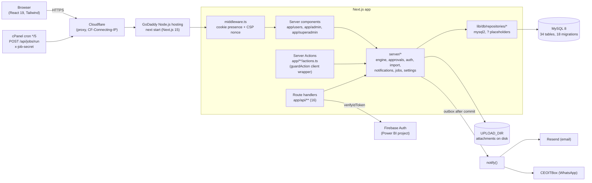

# ARS Approval Platform: application audit and current build status

| | |
|---|---|
| Audit date | 9 Oct 2026 |
| Code audited | `main` at v1.3.4 (`80937f0`), plus the Profile page change made the same day on the owner's request (v1.3.5, see §0) |
| Live site | https://approval.arssteels.net (GoDaddy Node.js hosting behind Cloudflare) |
| Method | Read-only code inspection of every route, server module, repository, migration, test and config file, done module by module (§12 lists what was covered). Safe local checks were run, and the latest CI run was read. Earlier recorded live tests are cited where they are the evidence. No migrations were run, nothing was deployed, and no production data was changed during the audit. |
| Secrets | No secret values appear in this report. Where a risk involves a secret, only its location is given. |

**Status words used (as defined in the brief):**
- **Verified working:** run by a test or seen live, with evidence.
- **Implemented, unverified:** the code exists, but no run has shown it working.
- **Partially implemented:** some of the required functionality exists, but important parts are missing.
- **UI only:** the screen exists without confirmed functional integration.
- **Mock/placeholder:** simulated or hard-coded behaviour.
- **Broken:** a failure was reproduced, or the code path provably cannot work.
- **Not implemented:** nothing was found after inspecting the relevant areas.
- **Blocked:** checking it needs access or services that weren't available.

---

## 0. Scope note: a change made during the audit

The owner asked, in the same message as the audit request, to move **Out of office, Notifications and Sign-in & devices** out of the user sidebar and into a **Profile** page. That is the only code change made today.
- **New files:** `app/users/profile/page.tsx`, `features/shell/ProfileTabs.tsx`, `getOwnProfile` in `lib/db/repositories/users.repository.ts`, and the test `tests/e2e/profile.spec.ts`.
- **Navigation edits:** `app/users/layout.tsx`, `features/shell/SideNav.tsx` (new `also` option) and `features/shell/ProfileMenu.tsx`.
- **Tabs added to existing pages:** `app/users/{notifications,delegation,security}/page.tsx`.
- **Addresses unchanged:** the old pages keep their URLs, so links in emails and WhatsApp still work.
- **Verification:** the new e2e test passes, and the full e2e suite passed 28/28 with it. Screenshots: `test-results/profile-desktop.png` and `profile-phone.png`.

Everything else in this document is read-only findings.

## Update: v1.4.0 (9 Oct 2026, owner: "fix every pending items in one go")
Every code item in this report is now done. The owner's tasks (data, Meta approvals, publish, UAT, pilot, key rotation) remain.

| Register | Status in v1.4.0 | Proof |
|---|---|---|
| X-03 BLOCKED-step recovery | Built (D-098) | `tests/engine/v140-engine.test.ts`, `tests/integration/v140.int.test.ts`, `tests/e2e/v140-ui.spec.ts` |
| WORK / NOTIFY nodes, designation and requester sources | Built (D-097) | same, plus `tests/workflows/v140-builder.test.ts` |
| Builder AND/OR, nested branches | Built (D-099) | `v140-builder.test.ts`, `v140-ui.spec.ts` |
| Multi-level escalation, R-08 | Built (D-100) | `session4.test.ts`, `v140.int.test.ts` |
| R-04 delete via engine, R-05, R-06, R-07, R-09, R-10, delegation lock, decisions audited, hold extends due | Fixed (D-107) | `v140.int.test.ts`, `migrate.int.test.ts` |
| S-06, S-07, P-01, P-03..P-07 | Fixed (D-102) | `password-sign-in.test.ts`, `google-provider.test.ts`, `user-rules.test.ts`, `log-redaction.test.ts`, `v140-api.spec.ts`, `tests/origin/origin-lock.spec.ts` |
| P-02, P-08, P-09 | Decided and kept, with reasons (D-102) | DEVELOPMENT-MEMORY |
| X-09 health, X-10 backups | Built (D-103, D-104); restore drill in CI | `backup.int.test.ts`, `v140-api.spec.ts` |
| Delivery receipts (S8-03) | Built; CEOITBox payload to confirm (DEPLOYMENT G6) | `receipts.test.ts`, `v140-api.spec.ts` |
| S8-02 bundle | Built | `v140-ui.spec.ts`, manual |
| D-01 dev advisories | 16 → 7 (one package, `braces`, with no fix; build-time only) (D-105) | `npm audit` |
| D-02, D-03, D-04 | Fixed | `confirm-bar.test.ts`, the docs |
| Load test (GL-03) | 50 people at once: 2,400 requests, 0 errors, p95 586 ms (local) | `tests/perf/load.spec.ts` |
| P5-04, P7-04, P8-02 | Built (D-106) | `v140-ui.spec.ts`, `reporting-views.int.test.ts`, `v140-api.spec.ts` |

**Regression on v1.4.0:**
- types and lint clean; unit 301; integration 81;
- e2e 38; QA 27/27; origin 1;
- production build OK; production audit 0.

## Update: fixes in v1.3.6 (9 Oct 2026, owner: "Go Ahead")

| ID | Fix | Proof |
|---|---|---|
| B-01 | `UserCommands` renders the confirmation bar; "Sign out everywhere" and "Deactivate user" ask first, then run | **Fixed in v1.3.6** (see the update above) |
| S-01 | Retry payloads stored encrypted (AES-256-GCM, `lib/security/delivery-payload.ts`), wiped when sent and after 7 days (`pruneDeliveryPayloads` in the job runner); older plain rows still readable | `tests/integration/jobs.int.test.ts` "stored message bodies": the DB text holds no token; the retry gets the original; cleared after send and after 7 days |
| S-02 | `lib/http/safe-next.ts` refuses `//`, backslashes, whitespace and control characters, and anything not resolving to this site; used by the login page and the sign-in panel | `tests/security/safe-next.test.ts` |
| S-03 | Each try claims an attempt with a conditional UPDATE (`reserveChallengeAttempt`) before the code is checked | `tests/integration/otp.int.test.ts`: 12 simultaneous tries give exactly 5 claims |
| S-04 | Resend calls abort after 15 s (`EMAIL_TIMEOUT_MS`); the failure is retryable | `tests/qa/qa-fixes.test.ts` "a hung email call gives up" |
| S-05 | Sessions end after **120 minutes without activity** (new Super Admin setting "Sign out after no activity", 15–720), as well as the 12-hour limit | `tests/integration/sessions.int.test.ts` |

**Regression after the fixes:**
- lint and type check clean;
- unit 266/266; integration 68/68;
- build OK;
- e2e 29/29; QA suite 27/27.

**Still open from the register:** S-06, S-07, R-04..R-10, P-01..P-06, D-01..D-04, and the not-implemented items (backups, health check, BLOCKED recovery, WORK/NOTIFY nodes).

---

## Deliverable 1: Executive summary

**What it is.** The platform is a web application that replaces **104 Asana approval projects** at ARS Steels with one approval system. Its north star is *multi-level approvals in any custom manner*:
- **Approval steps:** any number of levels, run one after another, in parallel, by any one approver, by any N of M, conditionally, or by amount band (DoA).
- **Approvers:** named people, groups, a role, the requester's manager or manager's manager, a department HOD, or a person picked in a form field.

**What has been built.** It is one Next.js 15 / React 19 / MySQL 8 app with three spaces:
- **`/users`:** everyone. Raise requests, decide, comment, attach files, custom approvals, out of office, profile and notifications.
- **`/admin`:** IT. Users, departments, designations, groups, the workflow builder with a form-field creator and DoA, working calendar, bulk import/export, insights, and four dashboards with CSV export.
- **`/superadmin`:** the itadmin account. Provider keys (encrypted), security settings, WhatsApp template authoring and sync, message delivery log with retry, audit log, all requests with soft delete, and demo data.

Behind these sit a graph-based approval engine, an outbox for notifications (email via Resend, WhatsApp via CEOITBox, plus an in-app inbox), SLA reminders and escalation, and one cron job runner. Sign-in is by Google (Firebase) or by User ID + password + a WhatsApp code.

**Maturity, by a measurable method:**
- **Plan items:** 272 of 348 checklist items are ticked done (78%), 9 were superseded and 67 are open. Many open P2–P6 items are built but were never ticked, because later session items replaced them (§11). The real figure for built features is therefore higher. Most of what is genuinely open is go-live, operations and owner work.
- **Automated checks today:**
  - type check and lint clean;
  - **262/262** unit tests and **28/28** end-to-end tests pass locally;
  - CI on v1.3.4 is green (checks, MySQL integration, e2e 27/27);
  - production dependency audit **0** vulnerabilities.
- **Live evidence:**
  - every page was checked live on 9 Oct (QA session 15);
  - a real approval (CUS-2026-000003) sent **email and WhatsApp** to the approver, and on approval to the raiser, all **SENT**.

**Most important working features:**
- the approval engine (all six node types it declares) and the workflow builder with DoA bands;
- the full request lifecycle (raise, approve, reject, changes and resubmit, hold, withdraw, reopen, handover, delegation, comments, attachments);
- role-based spaces with server-side checks;
- notifications with outbox and retries;
- bulk import;
- dashboards;
- the audit trail.

**Main gaps:**
1. **Broken:** "Sign out everywhere" and "Deactivate user" on the admin user page can never run (B-01).
2. **Not implemented:** backups and a restore drill, a health-check endpoint, recovery of a step that ends up with no approver ("BLOCKED"), WORK/NOTIFY nodes, delivery receipts, session idle timeout.
3. **Security hardening:**
   - set-password links are stored in plain text in failed-email retry data (S-01);
   - the post-login redirect can be pointed at another site (S-02);
   - the one-time-code attempt counter can be raced (S-03);
   - email sending has no timeout (S-04).
4. **Not loaded yet:** real master data and approval types (live has 2 users and no departments, designations or approval types).
5. **Ops:** the cron job is being set up; v1.3.4 or later must be published for its status line.

**Readiness:**
- **Development testing:** ready.
- **UAT:** ready once the masters and approval types are loaded and B-01 is fixed.
- **Production for all staff:** not yet. Backups (P0-21), B-01, the four S-items above and the go-live gate GL-01..07 (UAT, security review, load test, backup drill, key rotation, user guides, pilot) come first.

---

## Deliverable 2: Page and feature matrix

Verification key: **E2E** = Playwright suite (`tests/e2e`, in CI); **INT** = MySQL integration tests (in CI); **UNIT** = Vitest; **QA** = manual-run QA suite (`tests/qa-e2e`, 27/27 on 9 Oct); **LIVE** = seen working on approval.arssteels.net (9 Oct); **CODE** = code-confirmed only.

| ID | Module | Page/Feature | Frontend | Backend | Verification | Known gap |
|---|---|---|---|---|---|---|
| U-01 | Users | `/users` Overview (counts, waiting, recent) | Done | Done | E2E, LIVE | – |
| U-02 | Users | `/users/queue` Waiting for me | Done | Done | E2E | No paging; query has no LIMIT (`approvals.repository.ts:375`) |
| U-03 | Users | `/users/requests` My requests (search, status, paging 25) | Done | Done | E2E, QA | – |
| U-04 | Users | `/users/requests/[id]`: decide, resubmit, withdraw, reopen, files, comments, timeline, delete | Done | Done | E2E, INT, LIVE | Resubmit always restarts at the requesting step (`app/users/actions.ts:132`) |
| U-05 | Users | `/users/new` and `/users/new/[workflowId]` raise a request | Done | Done | E2E, INT | Live has no approval types yet |
| U-06 | Users | `/users/custom` Custom approval | Done | Done | E2E, LIVE | Each custom request makes a new workflow row (R-06) |
| U-07 | Users | `/users/profile` Profile (new) | Done | Done | E2E | – |
| U-08 | Users | `/users/notifications` (Profile tab) | Done | Done | E2E | Mark-all-read failure not shown; capped at 50, no "older" |
| U-09 | Users | `/users/delegation` Out of office (Profile tab) | Done | Done | INT, E2E | Overlap check only in code |
| U-10 | Users | `/users/security` Sign-in & devices (Profile tab) | Done | Done | E2E (nav), CODE (action) | Sign-out-everywhere errors ignored (`SignOutEverywhereButton.tsx:13`) |
| A-01 | Admin | `/admin` home cards | Done | Raw SQL in page | E2E | Query not in a repository (`app/admin/page.tsx:9-23`) |
| A-02 | Admin | `/admin/users`, `/new`, `/[id]` | Done | Done | E2E, UNIT | B-01 fixed in v1.3.6 |
| A-03 | Admin | `/admin/organisation` (departments + HOD, designations + approver flag) | Done | Done | E2E, LIVE | – |
| A-04 | Admin | `/admin/groups` | Done | Done | INT | Member remove has no confirm |
| A-05 | Admin | `/admin/workflows`, `/new`, `/[id]` builder, publish, test mode, form-field creator, DB-backed dropdowns | Done | Done | E2E, UNIT, INT, QA | No delete/archive; publish race (R-05); default DoA limits hard-coded (`new/page.tsx:28`) |
| A-06 | Admin | `/admin/doa` DoA table | Done | Done | E2E | One query per workflow |
| A-07 | Admin | `/admin/calendar` working days, holidays | Done | Done | UNIT, INT | Holiday remove has no confirm |
| A-08 | Admin | `/admin/import` CSV templates, check, import, export | Done | Done | E2E, UNIT, QA (loaders 45/45) | Not wrapped in `guardAction` (expired session gives a generic error) |
| A-09 | Admin | `/admin/insights` | Done | Done | CODE | – |
| A-10 | Admin | `/admin/dashboards/{utilisation,departments,approvers,raisers}` + CSV | Done | Done | E2E | Custom approvals excluded from type filter |
| S-01 | Super Admin | `/superadmin` provider status | Done | Done | LIVE | – |
| S-02 | Super Admin | `/superadmin/settings` (keys encrypted, test send, history) | Done | Done | UNIT, LIVE (email + WhatsApp test sends) | CEOITBox base URL accepts http (P-05) |
| S-03 | Super Admin | `/superadmin/templates`, `/[code]` WhatsApp templates | Done | Done | UNIT, LIVE (11/20 approved) | 8 security templates pending Meta; break-glass template rejected |
| S-04 | Super Admin | `/superadmin/deliveries` + Retry now + job-runner status | Done | Done | E2E, LIVE | – |
| S-05 | Super Admin | `/superadmin/audit` | Done | Done | LIVE | – |
| S-06 | Super Admin | `/superadmin/requests` + soft delete | Done | Done | E2E, LIVE | Soft delete leaves `state_json` as in progress (R-04) |
| S-07 | Super Admin | `/superadmin/import` | Done | Done | E2E | Same component as A-08 (intentional) |
| S-08 | Super Admin | `/superadmin/demo` (load, retire, try as) | Done | Done | UNIT, E2E | Reachable in production (by design, Super Admin only) |
| P-01 | Public | `/login` Google + password + WhatsApp code | Done | Done | UNIT, LIVE (Google) | Network error leaves button stuck (`SignInPanel.tsx`); open redirect S-02 |
| P-02 | Public | `/forgot-password`, `/set-password` | Done | Done | UNIT | Real WhatsApp OTP path blocked in tests |
| P-03 | Public | `/security/not-me` | Done | Done | CODE | Link reusable 7 days (S-07); network error not caught |
| X-01 | Engine | START, APPROVAL, SPLIT, JOIN, CONDITION, END | – | Done | UNIT (38), INT | **WORK and NOTIFY nodes: not implemented** |
| X-02 | Engine | Approver sources (8 kinds) | – | Done | UNIT | No designation source; eligibility not rechecked at run time |
| X-03 | Engine | BLOCKED step recovery | – | **Not implemented** | – | Only withdraw or delete get out |
| X-04 | Jobs | `/api/jobs/run` (outbox, retries, SLA, template sync, housekeeping, heartbeat) | – | Done | INT, E2E | Cron not yet confirmed on GoDaddy |
| X-05 | Jobs | SLA reminder + one escalation | – | Done | UNIT, INT | One level only; LIMIT 200 may starve (R-08) |
| X-06 | Notify | Email (Resend) | – | Done | LIVE (SENT) | No timeout (S-04) |
| X-07 | Notify | WhatsApp (CEOITBox) | – | Done | LIVE (SENT) | No delivery receipts (DELIVERED/READ never set) |
| X-08 | Notify | In-app inbox and bell | Done | Done | E2E | – |
| X-09 | Ops | Health check endpoint | – | **Not implemented** | – | – |
| X-10 | Ops | Backup and restore | – | **Not implemented** | Blocked | P0-21, GL-04 open |
| X-11 | Audit | Append-only audit log, events, comments (DB triggers) | – | Done | INT | Decisions go to `approval_events`, not `audit_logs` |

---

## Deliverable 3: Technical architecture

**How the parts connect:**
- **Pages** are server components. Each space's layout calls `requireArea(...)` (`server/authorization/guards.ts:18-33`). It redirects to `/login` when there is no session, and returns a plain 404 (with an audit entry) for the wrong role.
- **Forms** post Server Actions through `useActionForm`/`guardAction` (`features/ui/form.tsx`). Every action re-checks the session with `requireApiArea`.
- **Business logic** lives in `server/`:
  - `server/engine/*`: a pure graph engine;
  - `server/approvals/service.ts`: transactions, row lock plus `state_version` check, outbox;
  - `server/auth/*`, `server/import/*`, `server/notifications/*`, `server/jobs/*`.
- **Data access** goes only through `lib/db/repositories/*`, with one exception: `app/admin/page.tsx`.
- **Sessions** are an HMAC-signed `ars_session` cookie backed by a `user_sessions` row. The user is re-read on every request.
- **Settings and secrets:** provider keys are stored AES-256-GCM encrypted in `system_settings`. Server secrets come from environment variables, validated in `config/environment.ts`.

---

## Deliverable 4: Implemented functionality

### 4a. Verified by running it (tests or live)

| Module | Functionality | Evidence |
|---|---|---|
| Auth | Password + OTP rules, lockout, set/forgot password, session tokens, encryption, CSP | `tests/auth/*` (38), `tests/security/*` (17); unit run 9 Oct: 262/262 |
| Auth | Client IP from Cloudflare; per-IP limit can't be dodged | `tests/security/client-ip.test.ts`; QA-SEC-06 pass (QA 27/27, 9 Oct) |
| Access | Route guards per space, 404 for outsiders, security headers | `tests/e2e/guard.spec.ts` (CI green) |
| Engine | Graph execution, joins, conditions, DoA, builder, validator, simulate | `tests/engine/*` (38), `tests/workflows/*` (41) |
| Requests | Build → raise → approve, changes/resubmit, outsider 404, attachments, DoA, delete | `tests/e2e/approval-flow.spec.ts`, `session6/7/11.spec.ts`; `tests/integration/*` (65 at v1.3.4) |
| Import | CSV templates, check, import, export | `tests/import/import-plan.test.ts` (19), `session10.spec.ts`, loader QA 45/45 |
| Dashboards | Four dashboards and CSV | `session11.spec.ts` |
| Forms | Field creator, DB dropdowns, date fields | `session12.spec.ts`, `tests/workflows/form-fields.test.ts` |
| Form resilience | Failure messages, timeout, session-ended | `tests/ui/guard-action.test.ts`, loader QA |
| Cloudflare | No plain-text addresses (React #418 guard) | `tests/e2e/cloudflare-safe.spec.ts` (now includes `/users/profile`) |
| Jobs | Retry lease, rate-limit window, runner heartbeat | `tests/integration/jobs.int.test.ts`, `tests/e2e/job-runner.spec.ts` |
| Profile | Profile tabs, sidebar highlight, phone width | `tests/e2e/profile.spec.ts` (9 Oct) |
| **Live** | All pages 200 for IT Admin, 404 for plain user on admin spaces; email + WhatsApp end to end; Super Admin soft delete; designation and user edits | PLAN-CHECKLIST L15-01..15; DEVELOPMENT-MEMORY work log 9 Oct |

### 4b. Code-confirmed but not exercised by any test

| Item | Where |
|---|---|
| Google sign-in route (Firebase token check) | `app/api/auth/google/route.ts`, `server/auth/google-sign-in.ts` (seen working live by the owner; no automated test) |
| WhatsApp OTP send/verify end to end | `server/auth/otp-flow.ts` (unit-tested with fakes; real send blocked in tests) |
| "This wasn't me" lock | `app/api/auth/not-me/route.ts` |
| Logout and sign out everywhere APIs | `app/api/auth/logout`, `app/api/me/sign-out-everywhere` |
| Insights page | `app/admin/insights`, `insights.repository.ts` |
| Break-glass CLI | `scripts/admin/break-glass.js` |
| Daily template sync | `server/notifications/template-registry.ts` (runs inside the job runner) |

---

## Deliverable 5: Incomplete and missing functionality

**Not implemented:**
- **Backups and restore** (P0-21, GL-04). `docs/DEPLOYMENT.md:108` says to use GoDaddy "Export SQL". Attachments in `UPLOAD_DIR` aren't in cPanel backups.
- **Health-check endpoint.** `/api/auth/status` only answers whether you're signed in.
- **BLOCKED-step recovery.** IT Admins are told (`server/approvals/messages.ts:131`), but no action re-runs or reassigns the step.
- **WORK and NOTIFY engine nodes** (absent from `server/engine/types.ts:98`). The north-star docs list them.
- **Designation as an approver source.** The approver-designation rule (D-085) applies only when someone is chosen; it isn't rechecked when ROLE sources are resolved at run time.
- **Multi-level or automatic escalation.** There is one escalation to the manager plus IT Admins (`server/jobs/sla.ts`).
- **Delivery receipts.** No CEOITBox webhook (S8-03), so DELIVERED/READ are never set.
- **Session idle timeout.** `last_seen_at` is stored but never checked.
- **Notifications for RESUMED, RESUBMITTED and NODE_SKIPPED events** (`messages.ts` default branch).
- **S8-02 bundle:** audit-log CSV export, login-history view, attachments on custom approvals, hand-off after approval.
- **Workflow delete or archive** (only the active flag), and no unsaved-changes warning in the builder.
- **Monitoring and alerting.** The logger writes JSON lines to the console only.

**Partial:**
- **WhatsApp:** 11/20 templates live. Security events are SKIPPED until Meta approves them.
- **Builder conditions:** one comparison per branch or skip rule. The engine supports AND/OR groups, but the builder can't make them (`server/workflows/builder.ts:10-14`).
- **Branch nesting:** one level in the builder.
- **The `jobs` table** is only used for the heartbeat row; its queue columns are unused.

**Not loaded, not code:** departments, designations, users, groups and approval types on live (DEPLOYMENT Part K).

---

## Deliverable 6: Bugs and technical debt

| ID | Issue | Evidence | Impact | Priority | Recommended fix |
|---|---|---|---|---|---|
| B-01 | "Sign out everywhere" and "Deactivate user" on `/admin/users/[id]` never run | `features/admin/UserCommands.tsx:9` passes `confirm` but never renders `confirmBar`; `features/ui/form.tsx:97-100` waits for that confirmation | IT can't deactivate a leaver or kill their sessions from the UI. This is a core admin control. | **P1** | Render `confirmBar` in `Command`; add an e2e test |
| S-01 | Set-password link (raw token) saved in plain text when the email fails | `server/notifications/notify.ts:115` stores `{to, subject, text}` in `notification_deliveries.payload_json`; the link is in the text (`security-messages.ts:148`) | Anyone with DB or backup read access could take over that account for up to 72 h | **P1** | **Fixed in v1.3.6** (see the update above) |
| S-02 | Open redirect after sign-in | `app/(public)/login/page.tsx:12` accepts `/\evil.com` (browsers treat it as `//evil.com`) | Phishing via a crafted login link | **P2** | **Fixed in v1.3.6** (see the update above) |
| S-03 | OTP attempt limit can be raced | `otp-flow.ts:109` reads the count; `otp.repository.ts:95` increments unconditionally | Parallel guesses can go over 5 tries (still capped by the 30/15 min per-IP limit) | **P2** | **Fixed in v1.3.6** (see the update above) |
| S-04 | No timeout on Resend calls | `server/integrations/resend/client.ts:33` (no `signal`) | A hung Resend call delays the user's action and the cron run | **P2** | **Fixed in v1.3.6** (see the update above) |
| S-05 | No session idle timeout | `sessions.repository.ts:65-79`; `PLAN-CHECKLIST.md:528` | A left-open browser stays signed in for 12 h | P2 | **Fixed in v1.3.6** (see the update above) |
| S-06 | Locked account reveals that the User ID exists | `password-sign-in.ts:93-96` | Minor account enumeration | P3 | Return the generic message |
| S-07 | "Not me" link reusable for 7 days | `complete-sign-in.ts:118,238` | A forwarded link can re-lock the account after IT unlocks it | P3 | Make it single-use |
| R-04 | Soft delete cancels tasks but leaves `state_json` IN_PROGRESS with PENDING tasks | `request-admin.repository.ts:102`; `server/approvals/delete.ts` | Inconsistent state if a deleted request is ever restored or re-read by the engine; approvers aren't told | P2 | Add a DELETED terminal state via the engine, and bump `state_version` |
| R-05 | Publish race can leave a workflow with no published version | `approvals.repository.ts:179-184`; draft check outside the transaction (`service.ts:209`) | Rare: two admins publishing at once | P3 | Lock the definition row; check affected rows |
| R-06 | Custom approval = 3 separate transactions | `server/approvals/service.ts:505-519` | Orphan CUSTOM workflows when a submit fails; table growth | P3 | Use one transaction |
| R-07 | Handover keeps the old due/escalate times and the "already reminded" rows | `approvals.repository.ts:338` | The new approver may get no reminder | P3 | Reset `due_at` and the reminder rows on reassignment |
| R-08 | SLA scan `LIMIT 200 ORDER BY due_at` includes tasks already fully notified | `server/jobs/sla.ts:56-57` | With more than 200 old overdue tasks, new ones are never reminded | P2 (at scale) | Exclude tasks that already have both reminder kinds |
| R-09 | Request-number year from DB session time zone, not IST | `approvals.repository.ts:190` | Wrong year possible around New Year | P3 | Compute the year in IST |
| R-10 | Migrations not transactional, no down scripts | `scripts/database/migrate.js` | A failed file is half-applied and unrecorded | P3 | Document manual recovery; keep files small or idempotent |
| P-01 | CF-Connecting-IP trusted without checking the source | `lib/http/client-ip.ts` | Spoofable if the GoDaddy origin is reachable directly | P2 (verify) | Restrict the origin to Cloudflare IPs, or check that the GoDaddy origin isn't publicly reachable |
| P-02 | 52 MB body limit for all Server Actions, parsed before auth | `next.config.ts:86-87` | Unauthenticated memory pressure | P3 | Lower the limit; uploads already have their own caps |
| P-03 | Shared Firebase project; sign-in provider not checked | `lib/firebase/admin.ts`, `google-sign-in.ts` | Another verified-email provider in that project could link to an unlinked account | P3 | Require `firebase.sign_in_provider === "google.com"` |
| P-04 | An IT Admin can change another IT Admin's email/phone and send a set-password link | `server/admin/user-rules.ts:37-43` | Peer account takeover inside IT | P3 | Only Super Admin edits IT Admin contact details |
| P-05 | CEOITBox base URL setting allows `http://` | `server/settings/definitions.ts:42` | API key could be sent unencrypted (Super Admin only) | P3 | Require https |
| P-06 | Provider response bodies logged | `lib/logging/logger.ts:20` | Phone numbers or content may reach logs | P3 | Redact |
| D-01 | Dev-only dependency advisories | `npm audit`: 16 (5 moderate, 8 high, 3 critical) in vitest/esbuild/tinypool/braces; production 0 | Developer machines and CI only | P3 | Upgrade the test toolchain (vitest 2 → 4) in its own change |
| D-02 | UI loose ends | MarkAllRead and sign-out-everywhere errors ignored; holiday and group-member remove have no confirm; `/login` and `/security/not-me` don't catch network errors; `/users/queue` not paged | Confusing on failure | P3 | Route them through `guardAction`/`postJson`; add confirms and paging |
| D-03 | Small duplications | `SignInPanel.tsx` repeats `auth-client.ts` without try/catch; `STATUS_OPTIONS` ×2; `ROLE_LABEL` ×2; WhatsApp masking ×2; unused `NavItem.soon` | Maintainability | P3 | Consolidate |
| D-04 | Out-of-date docs | `README.md` ("planning complete; scaffold next"); `docs/qa/E2E-QA-REPORT.md` still lists DEF-E1/E2 open (fixed in v1.3.4); `DEPLOYMENT.md` Part O headed v1.0.1 | Misleading for new readers | P3 | Refresh |

No P0 issue was found. No secret is committed: `.env*` is ignored and only `.env.example` is tracked. The Firebase web config in `next.config.ts` is public by design.

---

## Deliverable 7: Test and verification report

**Run during this audit (9 Oct 2026, local):**

| Check | Command | Result |
|---|---|---|
| Type check | `npx tsc --noEmit` | Pass (0 errors) |
| Lint | `npm run lint` | Pass |
| Unit | `npx vitest run` | **262/262 pass** (29 files) |
| E2E | `npx playwright test` (local MySQL test DB, production build) | **28/28 pass**, including the new `profile.spec.ts` |
| Dependency audit | `npm audit --omit=dev` / `npm audit` | Production **0**; dev 16 (see D-01) |

**From CI (GitHub Actions run 37916221354 on `80937f0`, v1.3.4):**
- **Checks:** lint, typecheck, unit and build all pass.
- **Integration (MySQL 8):** pass.
- **E2E:** 27/27 pass.

**Earlier today on v1.3.4 (local), not repeated after the Profile change:**
- integration 65/65;
- QA suite 27/27 (`playwright.qa.config.ts`).

The Profile change touches no integration-tested code.

**Recorded earlier (docs/qa):**
- **Loader audit:** 70 pass, 0 fail, 2 blocked (TC-044, TC-083 need fault injection).
- **E2E QA report (v1.3.1):** 38 pass, 2 fail (both since fixed), 5 blocked.

**Live (9 Oct, recorded in PLAN-CHECKLIST L15):**
- page access and timings;
- Cloudflare #418 fix;
- email and WhatsApp end to end (CUS-2026-000002/3, cleaned up).

**Not in CI:** QA suite (27), loader audit (45), coverage and `npm audit`.

**Blocked / still required:**
- live Google sign-in automation;
- the real WhatsApp OTP path;
- Firefox and Safari;
- load and stress testing;
- backup and restore drill;
- CORS and origin probing behind GoDaddy;
- the first cron run on GoDaddy (needs the owner's setup and v1.3.4 published).

**Coverage gaps:**
- **No direct test:**
  - Google sign-in, OTP flow, auth HTTP helpers;
  - `server/authorization/guards.ts` (e2e only);
  - `approver-check.ts`, `view.ts`;
  - dashboards export (e2e CSV only);
  - settings test-send and values;
  - ten repositories;
  - most auth API routes.
- **Server actions:** covered by e2e only.

---

## Deliverable 8: Remaining development roadmap

| # | Area | Item | Depends on | Acceptance criteria |
|---|---|---|---|---|
| 1 | Critical fixes | B-01 confirm bar on account actions | – | Deactivate and Sign out everywhere ask, then run; e2e test covers both |
| 1 | Critical fixes | S-01 no plain-text link tokens in retry payloads | – | Failed set-password email leaves no token in `notification_deliveries`; retry still sends a working link |
| 1 | Critical fixes | S-02, S-03, S-04 | – | `/\x` next rejected (unit); 6th parallel OTP guess refused (integration); Resend call aborts after N s (unit) |
| 2 | Core completion | BLOCKED-step recovery (reassign or re-resolve by IT) | Engine change | A blocked request can be moved on by IT; audited; tests |
| 2 | Core completion | Builder AND/OR conditions and nested branches | – | Builder output covers what the engine supports; validator plus e2e |
| 2 | Core completion | Designation approver source; runtime eligibility check | D-085 | Pick "any active approver with designation X"; ineligible people skipped |
| 2 | Core completion | Notifications for resume, resubmit, skip | – | Events produce messages; templates added |
| 2 | Core completion | S8-02 bundle (audit CSV, login history, attachments on custom, hand-off) | – | Each on screen with a test |
| 3 | Integration & data | Load real masters and approval types (DEPLOYMENT Part K) | Owner data | Departments, designations (approvers ticked), users, groups imported; first predefined type published and used |
| 3 | Integration & data | WhatsApp security templates approved | Meta | 20/20 templates live; no SKIPPED for security events |
| 3 | Integration & data | Delivery receipts (CEOITBox webhook, S8-03) | Provider | DELIVERED/READ visible on deliveries |
| 4 | Security | Idle timeout; single-use "not me" links; Google provider check; IT Admin peer-edit rule; https-only provider URL; log redaction | – | Each has a unit or integration test |
| 4 | Security | Confirm the origin only accepts Cloudflare (P-01) | Hosting | Direct origin request refused, or documented as unreachable |
| 4 | Security | Rotate the keys pasted in chat (Firebase, CEOITBox) | Owner | New keys in settings; old revoked |
| 5 | UI/UX | Queue paging; notification history; network-error handling on login and not-me; confirms on removes; workflow archive and unsaved warning | – | e2e tests per item |
| 6 | Testing | Run the QA suite and `npm audit` in CI; dev toolchain upgrade (D-01) | – | CI job green; dev audit 0 |
| 7 | Production readiness | Publish v1.3.5; cron set up and green on Message deliveries | Owner | Job runner line green; failed sends retry |
| 7 | Production readiness | Backups: scheduled DB export + attachments copy; restore drill (P0-21, GL-04) | Hosting | A restore into a scratch DB succeeds and is documented |
| 7 | Production readiness | Health endpoint and uptime monitor | – | `/api/health` checks DB; external monitor alerts |
| 7 | Production readiness | Go-live gate GL-01..07 (UAT, security review, load test, backup drill, key rotation, user guides, pilot) | All above | Each signed off in PLAN-CHECKLIST |

---

## Deliverable 9: File-level implementation map

| Feature | UI | Server / actions | API | Repositories | Tables |
|---|---|---|---|---|---|
| Sign-in (Google) | `app/(public)/login`, `features/auth/components/SignInPanel.tsx` | `server/auth/google-sign-in.ts`, `complete-sign-in.ts` | `/api/auth/google` | users, sessions, audit | users, user_sessions, user_devices, login_logs, audit_logs |
| Sign-in (password + OTP) | same | `server/auth/password-sign-in.ts`, `otp-flow.ts`, `rate-limit.ts` | `/api/auth/password/{start,verify,resend}` | otp, users, jobs (rate) | otp_challenges, rate_limit_hits |
| Set / forgot password | `app/(public)/{set-password,forgot-password}` | `server/auth/set-password.ts` | `/api/auth/set-password/*`, `/api/auth/forgot/*` | password-tokens | password_tokens |
| Sessions, guards | all layouts | `server/auth/session.ts`, `server/authorization/{guards,policy}.ts`, `middleware.ts` | `/api/auth/{status,logout}`, `/api/me/sign-out-everywhere` | sessions | user_sessions |
| Raise / decide / lifecycle | `app/users/{new,requests}`, `features/requests/*` | `app/users/actions.ts`, `server/approvals/service.ts`, `server/engine/*` | – | approvals | approval_requests, approval_tasks, approval_events, request_sequences, notification_outbox |
| Custom approval | `app/users/custom`, `CustomApprovalForm` | `app/users/collab-actions.ts`, `service.ts:461-520` | – | approvals | workflow_definitions, workflow_versions |
| Comments, out of office, inbox | `app/users/requests/[id]`, `app/users/{delegation,notifications}` | `server/approvals/collab.ts` | – | collab | request_comments, delegations, notifications |
| Profile | `app/users/profile`, `features/shell/ProfileTabs.tsx` | – | – | users (`getOwnProfile`) | users, departments, designations |
| Attachments | `RequestForm`, request page | `server/attachments/service.ts` | `/api/attachments/[id]` | attachments | request_attachments (+ UPLOAD_DIR) |
| Workflow builder, forms, DoA | `app/admin/workflows`, `features/admin/{WorkflowBuilder,FormFieldsEditor,LevelsEditor}` | `app/admin/workflows/actions.ts`, `server/workflows/{builder,doa}.ts`, `server/forms/fields.ts`, `server/engine/{simulate,validate}.ts` | – | approvals, lookups | workflow_definitions, workflow_versions |
| Users and organisation | `app/admin/{users,organisation,groups}` | `server/admin/{users,user-rules,organisation}.ts`, actions | – | admin-users, organisation, groups | users, user_roles, departments, designations, approver_groups(_members) |
| Calendar | `app/admin/calendar` | `server/workflows/calendar.ts` | – | calendar | holidays, system_settings |
| Import / export | `features/admin/ImportPanel.tsx` | `server/import/*`, `app/admin/import/actions.ts` | `/api/admin/import/[kind]` | import | users, departments, designations, approver_groups, holidays |
| Dashboards, insights | `app/admin/{dashboards,insights}`, `features/admin/dashboards/*` | `server/dashboards/export.ts` | `/api/admin/dashboards/[slug]` | dashboards, insights | read-only |
| Notifications | inbox, bell | `server/notifications/{notify,templates,template-registry,security-messages}.ts`, `server/approvals/messages.ts` | – | notifications, outbox, whatsapp | notifications, notification_deliveries, notification_outbox, whatsapp_* |
| Providers | `app/superadmin/settings` | `server/settings/*`, `server/integrations/{resend,ceoitbox}` | – | settings | system_settings, settings_change_history |
| Job runner | `app/superadmin/deliveries` | `server/jobs/{retry-deliveries,sla}.ts` | `/api/jobs/run` | jobs, outbox | notification_deliveries, task_reminders, jobs, rate_limit_hits |
| Audit | `app/superadmin/audit` | everywhere via `audit.repository` | – | audit | audit_logs (append-only triggers) |
| Super Admin delete | `app/superadmin/requests` | `server/approvals/delete.ts` | – | request-admin | approval_requests (soft delete) |
| Demo | `app/superadmin/demo` | `server/demo/{service,demo-data}.ts` | – | – | users (`is_demo`) and masters |

---

## Deliverable 10: Final application status

- **Complete:**
  - the engine (6 node types, 8 approver sources, ALL/ANY/ANY-N, conditions, DoA);
  - the request lifecycle;
  - three role spaces with server-side checks;
  - builder with form fields and DB dropdowns;
  - import/export, dashboards, settings with encrypted keys;
  - WhatsApp template authoring;
  - notifications with outbox and retries;
  - audit trail;
  - the new Profile page.

  All are verified by tests (CI green) and, where noted, live.
- **Incomplete:**
  - backups and restore;
  - health check and monitoring;
  - BLOCKED-step recovery;
  - WORK/NOTIFY nodes;
  - multi-level escalation;
  - delivery receipts;
  - idle timeout;
  - S8-02 bundle;
  - builder AND/OR;
  - 9 WhatsApp templates;
  - real master data and approval types.
- **Broken:** B-01 (admin "Deactivate user" and "Sign out everywhere"). Nothing else was reproduced as broken.
- **Unverified:**
  - which version is live on GoDaddy (last confirmed live: v1.3.1 in QA session 15, with later fixes reported working by the owner);
  - the cron job's first run;
  - live Google sign-in and WhatsApp OTP by automation;
  - Firefox and Safari;
  - load;
  - whether the origin is reachable without Cloudflare.
- **Address first:**
  1. B-01;
  2. S-01;
  3. publish v1.3.5 and confirm the cron is green;
  4. backups;
  5. S-02..S-05;
  6. load masters and approval types for UAT.
- **Evidence needed before production release:**
  - a restore drill record;
  - green job-runner status on live;
  - UAT sign-off on real approval types;
  - security review of S-items closed;
  - key rotation done;
  - a pilot department run;
  - a load test at the expected volume (104 approval types' worth of traffic).

---

## 12. Coverage checklist (what was inspected)

| Area | Inspected | Notes |
|---|---|---|
| `app/` pages (43), layouts, error pages, route handlers (16), Server Action files (13) | Yes | Large client components (WorkflowBuilder, FormFieldsEditor, TemplateForm, RequestForm, CustomApprovalForm) were searched, not read line by line |
| `server/` (engine, approvals, auth, admin, import, notifications, jobs, settings, demo, integrations) | Yes | |
| `lib/` (db, repositories, http, security, session, logging, firebase) | Yes | |
| `database/migrations` (18) and seeds, `scripts/` | Yes | Not executed |
| `tests/` (unit, integration, e2e, qa-e2e, qa-loaders) and CI workflow | Yes | Unit and e2e executed; integration and QA from today's earlier runs and CI |
| `docs/`, living files, `next.config.ts`, `middleware.ts`, `.env.example` (names only), `.gitignore`, `docker-compose.yml`, `package.json` | Yes | |
| Live site | Not re-probed for this report | Live evidence is from today's recorded sessions (L15) |
