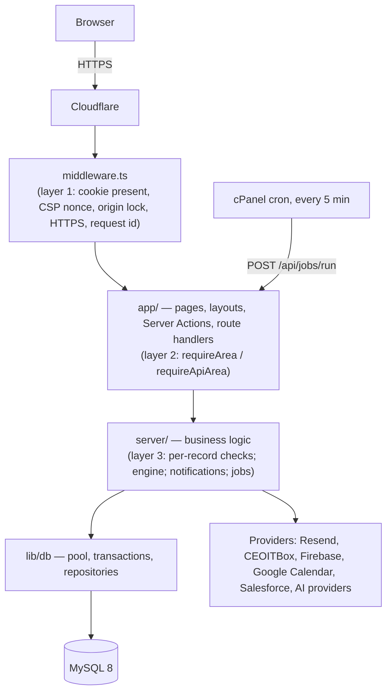

# Architecture: ARS-CMS

| | |
|---|---|
| Applies to | **v1.39.0 (31 Oct 2026)** |
| Replaces | The core-architecture parts of `application-audit/01_APPLICATION_ARCHITECTURE.md` (a v1.8.0 snapshot, not maintained) |
| Companion pages | `docs/DATA_MODEL.md` (tables and ERD), `docs/API_REFERENCE.md` (every route handler), `docs/AUTOMATION_INVENTORY_AND_RECOVERY.md` (background jobs) |
| Keep up to date | Check this page at every release that adds a layer, a module, an integration or a security mechanism |

Module write-ups that go deeper: `docs/ai-module/architecture.md` (AI module), `docs/CHATBOT_ARCHITECTURE_AUDIT.md` (Pico Bot), `docs/ADMIN_CONFIGURATION_STUDIO_ARCHITECTURE.md` (Form and Workflow Designer).

## 1. The big picture

One Next.js 15 app (React 19, TypeScript, Tailwind) on GoDaddy Node.js Hosting behind Cloudflare, with one MySQL 8 database. Three spaces in the same app:

| Space | Who | What |
|---|---|---|
| `/users` | Everyone (roles USER, IT_ADMIN, SUPER_ADMIN) | The Central Management System: approvals, tasks and projects, information, AI assistant, calendar, analytics, profile |
| `/admin` | IT team (IT_ADMIN, SUPER_ADMIN) | Approval types, forms and workflows, users and organisation, module set-up, reminders, reports |
| `/superadmin` | Super Admin only | Settings and providers, integrations, AI settings, page access, automation, audit, backups |

Public pages (`/`, `/privacy`, `/terms`, the sign-in pages) live in `app/(public)` and the auth routes.

## 2. Layers and folders

The rule is **`app/` → `server/` → `lib/db`**, never the other way round. Client components never import `server/` or `lib/db` (those files start with `import "server-only"`).

| Folder | Holds | Rules |
|---|---|---|
| `app/` | Routes: pages, layouts, `error.tsx` per space, `actions.ts` files (Server Actions), `app/api/**/route.ts` (route handlers) | Thin. Every entry point checks access first (§4), parses its input, then calls `server/` |
| `features/` | React components by area (`shell`, `requests`, `work`, `admin`, `ai`, `analytics`, …) | UI only. Data comes from the page or a Server Action |
| `server/` | Business logic by domain: `approvals`, `engine`, `workflows`, `forms`, `work`, `modules`, `notifications`, `calendar`, `ai`, `reports`, `analytics`, `ops`, `auth`, `authorization`, `settings`, `integrations`, … | Owns the rules. Opens transactions, records audit, queues notifications |
| `lib/db/` | `client.ts` (one `mysql2` pool per process, cached on `globalThis`), `transaction.ts`, `repositories/*` (SQL) | All SQL lives in repositories; queries use placeholders |
| `lib/` (other) | `security/` (encryption, hashing, password, OTP, CSP, signed paths), `session/` (cookie names, token), `logging/` (structured log, request id), `http/` (API response envelope), `firebase/` | No business rules |
| `config/environment.ts` | The validated environment (zod) | Read once; a missing or bad value fails with a clear message |
| `database/` | `migrations/` (applied on start), `seeds/`, `optional/` (run by hand) | Migrations only add (see `docs/DATA_MODEL.md`) |
| `scripts/` | `database/` (migrate, seed, restore, verify-backup, check-privileges), `docs/` (register builder) | Run with Node, outside the app |

**Pages do their work through Server Actions.** Route handlers exist only where an action can't serve: sign-in steps, file downloads, OAuth callbacks, webhooks, the job runner and the health check (`docs/API_REFERENCE.md`).

**Transactions and notifications.** `withTransaction` (`lib/db/transaction.ts`) commits or rolls back one unit of work. Notifications are queued in the outbox inside the transaction and sent **after** the commit, so a failed email or WhatsApp never undoes a business action (D-029). `notify()` (`server/notifications/notify.ts`) never throws.

## 3. Authentication and sessions

| Way in | Code | Notes |
|---|---|---|
| Google | `server/auth/google-sign-in.ts` | Firebase Auth (the Power BI site's project). The person must already exist with method GOOGLE or BOTH, matched on the primary email. No OTP (D-006) |
| User ID + password + WhatsApp code | `server/auth/password-sign-in.ts`, `otp-flow.ts` | Password checked first, then a code by WhatsApp only (CEOITBox), with cooldown and an hourly cap (D-025) |
| Set / forgot password | `server/auth/set-password.ts` | Links from IT's invite or the forgot-password page |
| Try as (IT) | `server/auth/try-as.ts` | One-time link (5 minutes) for a private window; the session is view-only, lasts at most an hour, and is audited (D-185) |
| Break-glass | `server/auth/break-glass-alert.ts` | Emergency account; its sign-in alerts the Super Admin |

All of them end in `server/auth/complete-sign-in.ts`, which writes a **session row** and sets the cookie.

- **Cookie** `ars_session`: an HMAC-SHA256-signed token (`lib/session/token.ts`, key `SESSION_SECRET`) holding only the session id, user id and times. It expires 12 hours after sign-in (`SESSION_TTL_SECONDS`).
- **Every request** re-checks the session row (not revoked, not expired) and re-reads the user (active flag, roles). Deactivation, a role change or **Sign out everywhere** apply at once (`server/auth/session.ts`).
- **Idle sign-out:** the setting `auth.idle_timeout_minutes` (default 30, 5–480), for everyone including the Super Admin. The browser warns two minutes before (`features/shell/SessionWatch.tsx`).
- **Device cookie** `ars_device` remembers a device for new-sign-in alerts; **This wasn't me** signs the person out everywhere and locks the account.
- Sign-in steps are rate-limited (`server/auth/rate-limit.ts`) and every attempt is in `login_logs`.

## 4. Authorization

Three layers. Hiding a link is never the protection.

1. **`middleware.ts`** only checks that a session cookie is present (and adds the CSP nonce, the request id, HTTPS redirects, the Cloudflare origin lock when `ORIGIN_SECRET` is set, and a same-site check on state-changing API calls). Security never depends on it alone.
2. **The area guard** (`server/authorization/guards.ts`):
   - `requireArea(area)` for pages and layouts: no session → sign-in (or `/signed-out?reason=…`); signed in without the role → a plain 404, so `/admin` and `/superadmin` don't confirm they exist. Every denial is audited (`AREA_ACCESS_DENIED`).
   - `requireApiArea(area, { change, page })` for route handlers and Server Actions: throws `ForbiddenError`, which the caller maps to a generic "not found".
   - The roles per area are in `server/authorization/policy.ts` (`AREA_ROLES`).
3. **Page access** (`server/authorization/page-access.ts`, set by the Super Admin at `/superadmin/pages`): each page of My approvals and the Admin space is Full, View only or Hidden, for everyone, a department or a person (the most specific rule wins). Both guards apply it: a hidden page is a 404 (`PAGE_ACCESS_DENIED` audited); a view-only page can be read but its actions refuse. An action names its page so the rule holds wherever it is posted from. A module the person doesn't have is refused like a hidden page (D-168). The Super Admin is never limited.

Then, **per record**, `server/` checks who may see or act on each request, task, project, information item or file (e.g. `lib/db/repositories/visibility.ts`; only the approver of a pending task or their active delegate can decide it). Feature switches (`server/settings/features.ts`) turn modules on or off; they are not access checks.

## 5. The approval engine

`server/engine/` is the heart of the north star: **multi-level approvals in any custom manner**.

- A workflow is a **node graph**, not fixed levels: START, APPROVAL (mode APPROVE or WORK), NOTIFY (FYI), SPLIT and JOIN (ALL, ANY_ONE, ANY_N), CONDITION, END (`server/engine/types.ts`). Sequential, parallel, any-one, any-N-of-M, conditional and DoA routing all combine freely.
- **Pure functions:** (definition, state, input) → new state + events (`engine.ts`). The caller (`server/approvals/service.ts`) loads the request, runs the engine inside a transaction, saves the state, records the timeline and audit, and turns the events into outbox messages.
- **Approver sources** are resolved to active people at the time the step opens: named people, reporting manager (and theirs), department HOD, group, role, a person on the form, everyone with a designation, or the requester (work and FYI only). The requester never approves their own request.
- `validate.ts` checks a definition before publishing; `simulate.ts` powers **Test mode**; `conditions.ts` evaluates the rule rows shared with the Form Designer.
- **Versions:** each approval type has versions (`workflow_versions`). IT edits one working draft that saves as it goes (v1.39.0: `draft_revision` refuses a save from an older revision), checks it, and publishes. A request keeps the version it was raised on.
- Request states (`approval_requests.status`): in progress, on hold, changes required, approved, rejected, cancelled (FLOWS F-10). Unsent drafts are kept apart, in `request_drafts`.

Tasks & projects (`server/work`, `server/modules`) and Information (`server/modules`) are separate modules with their own lifecycles; completing a task never approves a request.

## 6. Background jobs

One cron call, `POST /api/jobs/run` with header `x-job-secret` (`JOB_RUNNER_SECRET`), every 5 minutes. `runAutomations()` (`server/ops/automation.ts`) runs **16 steps** in turn; each is recorded in `job_runs`, and one failing step doesn't stop the others. The runner heartbeat feeds `/api/health` (`jobRunner`). Full list, retries and recovery: `docs/AUTOMATION_INVENTORY_AND_RECOVERY.md`.

The daily backup is one of the steps (`server/ops/backup.ts`); restore uses `scripts/database/restore.js` and `verify-backup.js` (`docs/BACKUP_RESTORE_AND_ROLLBACK.md`).

## 7. Integrations

| Integration | Code | Direction | Keys kept in |
|---|---|---|---|
| Resend (email) | `server/integrations/resend` | Out | Encrypted setting |
| CEOITBox (WhatsApp codes and messages, templates) | `server/integrations/ceoitbox`; receipts at `/api/webhooks/ceoitbox` | Out; receipts in | Encrypted settings (API key, webhook secret) |
| Firebase Auth (Google sign-in) | `lib/firebase`, `server/auth/google-sign-in.ts` | In (token check) | Env vars `FIREBASE_*` |
| Google Calendar (two-way sync per person) | `server/calendar`, `server/integrations/google-calendar`; OAuth at `/api/integrations/google-calendar/*`; changes at `/api/webhooks/google-calendar` | Both | Encrypted settings; per-person tokens encrypted in the database |
| Salesforce (read-only copy for Pico Bot) | `server/ai/connectors/salesforce*.ts`; OAuth (PKCE) at `/api/integrations/salesforce/*` | In | Encrypted settings |
| AI providers (Claude, ChatGPT, Grok, DeepSeek, Groq, Gemini, NVIDIA) | `server/ai/providers.ts` | Out | Encrypted settings; calls only from the server |

Every provider call happens on the server. A provider failure is recorded and retried by the job steps; it never blocks the business action.

## 8. Settings and encryption

- **Settings** are defined in `server/settings/definitions.ts` (key, group, type, zod schema, default, `encrypted` flag) and stored in the database. The Super Admin edits them in the settings console (`/superadmin/settings`). `server/settings/values.ts` resolves a value on the server and decrypts secrets there; secret values are never sent back to the browser.
- **Encryption:** AES-256-GCM (`lib/security/encryption.ts`), stored as base64(iv ‖ auth tag ‖ ciphertext), with the 32-byte key from env var `ENCRYPTION_KEY`. **Losing `ENCRYPTION_KEY` makes every saved provider key unreadable**: keep it in the password manager, never in the repository.
- **Server secrets** (`SESSION_SECRET`, `ENCRYPTION_KEY`, `JOB_RUNNER_SECRET`, `ORIGIN_SECRET`, `FIREBASE_PRIVATE_KEY`, database credentials) are GoDaddy environment variables only (`config/environment.ts`). Provider keys are never environment variables. Nothing secret is committed.

## 9. Cross-cutting

- **Audit log:** `recordAudit` writes `audit_logs`, protected by append-only triggers; the Super Admin exports it as CSV.
- **Logging:** structured lines with a request id (Cloudflare's CF-Ray or a new id) that users see as "Reference" in **Copy details for IT**. No payloads or secrets in logs.
- **Security headers:** a per-request CSP nonce; file downloads keep their own sandboxed policy.
- **Rate limits** on sign-in, downloads, webhooks and search.
- **Tests:** Vitest unit and MySQL integration suites, Playwright end-to-end, QA and origin suites; CI runs them on every push to `main` (`README.md` → Tests).
