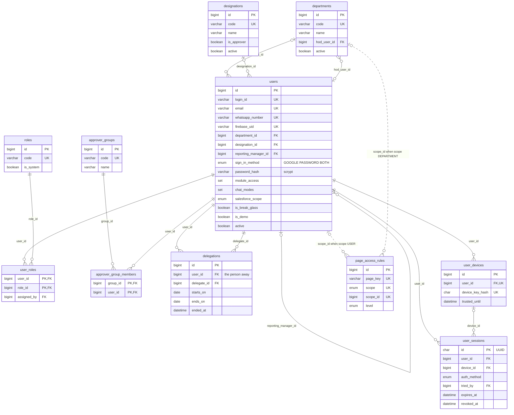
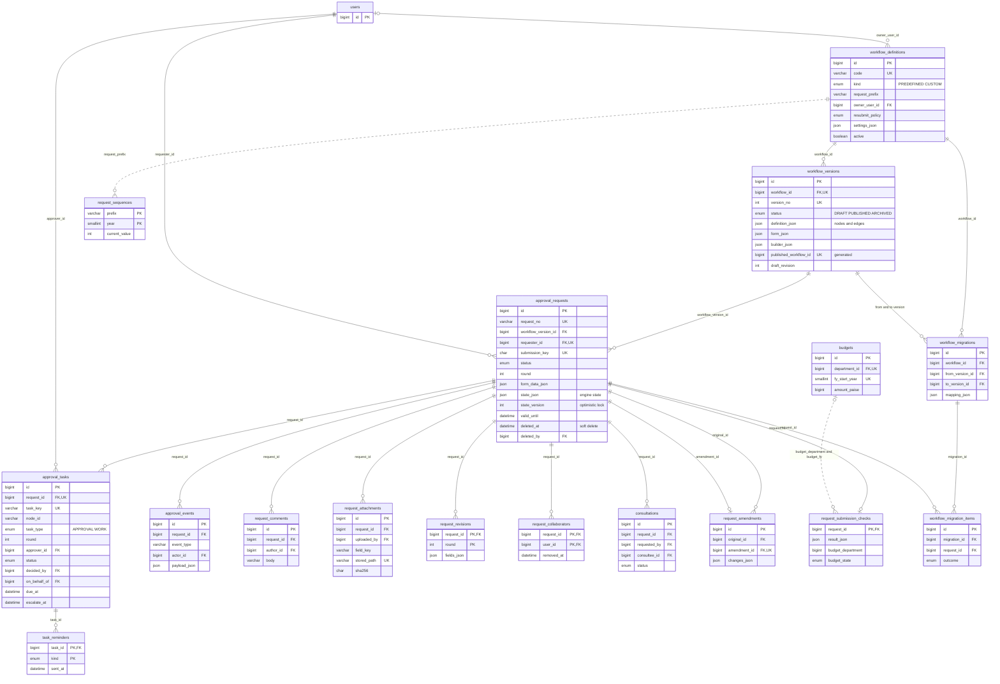
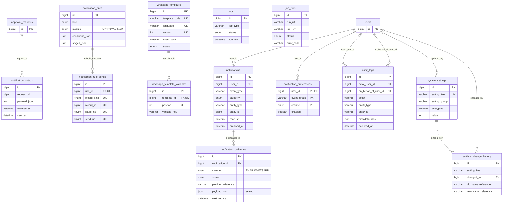
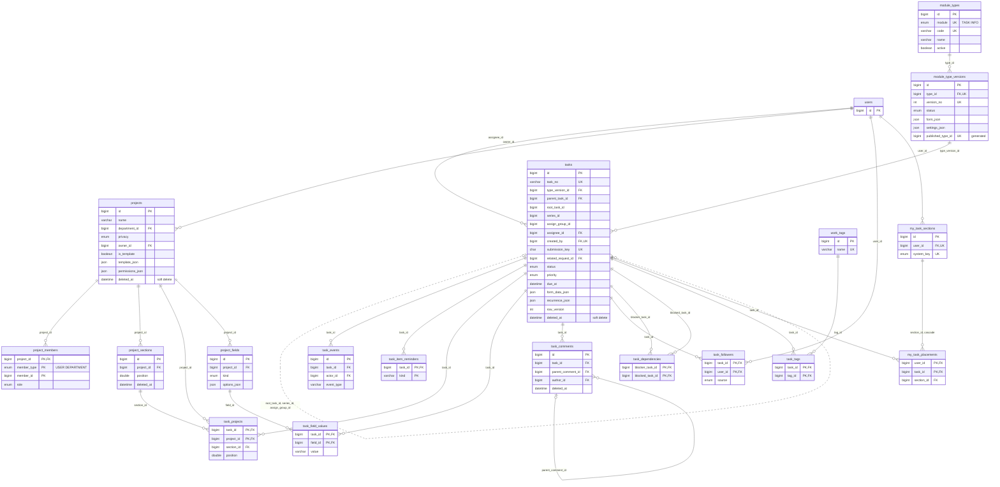
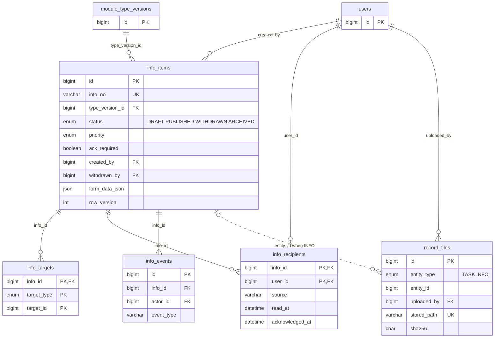
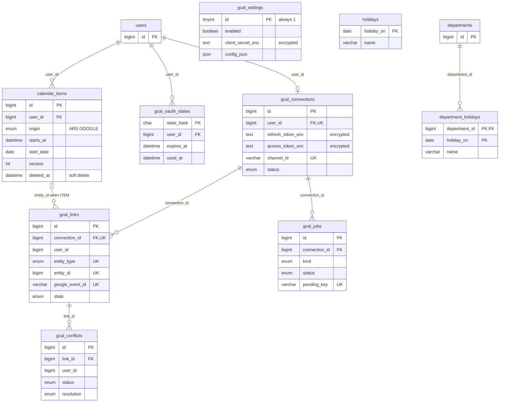
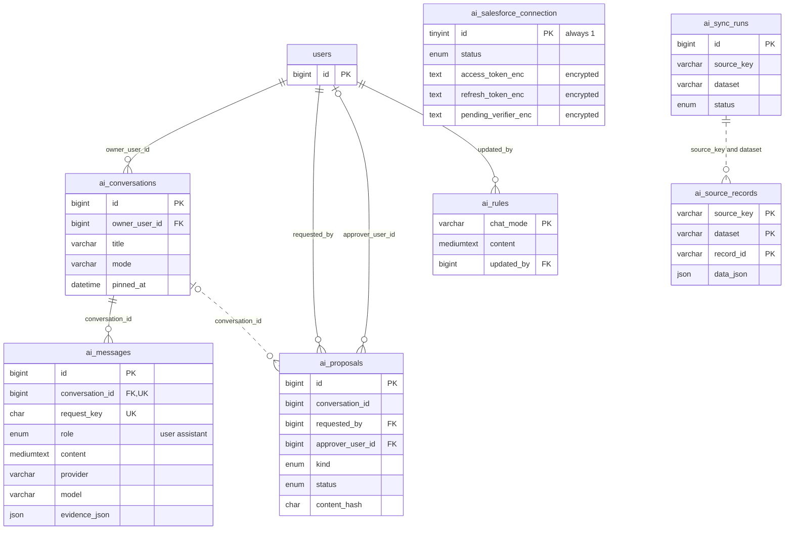

# Data model: ARS-CMS database (tables and relationships)

Applies to v1.46.0 (2 Nov 2026). Earlier: v1.39.0 (31 Oct 2026).

| | |
|---|---|
| Database | MySQL 8.0 (`docker-compose.yml` uses `mysql:8.0`; GoDaddy's Hosted Database is MySQL 8). Every table is InnoDB, `utf8mb4` / `utf8mb4_unicode_ci` |
| Source of truth | `database/migrations/*.sql`, **52 files**, from `202609281200_create_organisation.sql` to `202611021000_unify_condition_rules.sql` (48 at v1.39.0; v1.40.0 added 2, v1.41.0 1, v1.46.0 1) |
| Tables | **114** made by the migrations, plus **2** made by the migration runner itself (`schema_migrations`, `schema_migration_progress`) = 116 (v1.39.0: 110 + 2; since then `hod_report_runs`, `push_subscriptions`, `admin_broadcasts`, `condition_rules_backup`) |
| Fixes | Audit defect OPS-17 ("No ERD covers the 48 migrations") |

This page is a map, not a copy of the SQL. When the two differ, the SQL wins. Update this page in the same change as any new migration.

## Contents
- **1.** How migrations are applied
- **2.** Diagrams (7, one per area)
- **3.** Every table
- **4.** Notable constraints

---

## 1. How migrations are applied

- **The runner:** `scripts/database/migrate.js` (`npm run db:migrate`). It reads `database/migrations/*.sql` in file-name order (`YYYYMMDDHHMM_description.sql`) and applies those not yet listed in `schema_migrations`.
- **Resume after a failure:** MySQL can't roll back table changes, so progress is saved per statement in `schema_migration_progress`. After fixing the cause, the next run carries on from the statement that failed.
- **Triggers:** a trigger body sits between `-- @begin` and `-- @end` lines and is sent as one statement. A block marked `-- @optional` is skipped with a warning when the database user isn't allowed to create triggers; IT then runs `database/optional/v190_append_only_triggers.sql` once in phpMyAdmin.
- **On start:** `npm start` is `migrate.js && seed.js && next start`, so every production start applies new migrations and seeds before the app opens. The Next.js app itself doesn't migrate: no code under `app/`, `server/` or `lib/` touches `schema_migrations`, and there is no `instrumentation` file. `npm run start:app` starts the app without migrating.
- **Seeds:** `database/seeds/` (roles, the WhatsApp sign-in code template, the first Super Admin), run by `scripts/database/seed.js`.
- **Not migrations:** `database/optional/reporting_views.sql` (two read-only Power BI views, `reporting_requests` and `reporting_tasks`), `database/optional/v190_append_only_triggers.sql` and `database/optional/v1421_qa_indexes.sql` (v1.43.0: two additive indexes, `notifications (user_id, archived_at, id)` and `tasks (assignee_id, status, completed_at)`, run once the owner approves; only speed). IT runs them by hand.
- **Work-step tasks (D-269):** a `tasks` row made for an approval work step has `related_request_id` set and `form_data_json.__approvalWork = { requestId, taskKey }`; no column was added.
- **Background work (D-273, v1.44.0):** a work step with `background: true` (builder `holdsUp: false`) records the event `WORK_ASSIGNED` (`approval_events.payload_json = { nodeId, label, userIds, slaHours? }`) and the node state `assigned`; each person gets a `tasks` row with `related_request_id` and `form_data_json.__approvalLink = { requestId, key: "<event id>:<user id>", nodeId }`. No column was added.
- **The rule: migrations only add.** New tables, new nullable or defaulted columns, new indexes, new enum values. Older code keeps working on a newer database, so a rollback is "redeploy the previous release". Never edit a migration that has shipped; add a new one. The few `MODIFY COLUMN` statements only widen (more enum values, a longer `VARCHAR`, `request_submission_checks.request_paise` made signed). Two data changes exist: `202610081400_super_admin_google_email.sql` changes the bootstrap Super Admin's email once, and **`202611021000_unify_condition_rules.sql` (v1.46.0)** rewrites saved form rules into the one rule shape (§4, "v1.46.0"). The second is the one exception to "older code keeps working": v1.45.0 can't read the new shape, so its rollback statements (in the file header) must be run when going back.

---

## 2. Diagrams

How to read them:
- Only key columns are shown: primary key, foreign keys, and a few that matter. Types are simplified (`varchar` for `VARCHAR(n)`, `datetime` for `DATETIME(3)`).
- `PK` primary key, `FK` foreign key, `UK` part of a unique key.
- A **solid line** is a real `FOREIGN KEY` constraint. A **dotted line** is a link **by convention only** (an id column with no constraint; the app keeps it right).
- `users` appears as a short stub in most diagrams; its full shape is in 2.1. Almost every table also has `created_by` / `updated_by` FKs to `users`; most of those are left out to keep the pictures readable.

### 2.1 People, organisation and access

By convention: `page_access_rules.scope_id` points at a user or a department depending on `scope` (0 for EVERYONE). The reporting hierarchy is `users.reporting_manager_id`, a self-reference.

### 2.2 Workflows, requests and approval steps

By convention: `request_sequences.prefix` matches `workflow_definitions.request_prefix` (one row per prefix and year, locked while a number is taken); `request_submission_checks.budget_department` / `budget_fy` match a `budgets` row but have no FK. The engine's steps live in `workflow_versions.definition_json` and the request's `state_json`; `approval_tasks` is a projection of them for queues. Also linked to `approval_requests` by real FKs, not drawn: `request_links` (two FKs), `recent_views`, `stuck_snoozes`, `tasks.related_request_id`.

### 2.3 Notifications, audit, settings and jobs

By convention: `notification_outbox.request_id`, `notifications.entity_type` / `entity_id`, `notification_rule_sends.record_kind` / `record_id` (an `approval_tasks` or `tasks` id), `audit_logs.entity_type` / `entity_id` / `session_id`, and `settings_change_history.setting_key`. `jobs` and `job_runs` have no FKs. There is no backups table: the daily backup is the `backup` automation, and each run is a `job_runs` row.

### 2.4 Tasks and projects

By convention: `tasks.root_task_id`, `series_id` and `assign_group_id` (all point at another `tasks` row), `project_members.member_id` (a user or a department, by `member_type`), `work_views.scope_id` (a user or a project), `work_likes.target_id`, `work_favourites.object_id`, and `task_followers.added_by` / `task_comments.deleted_by` (no FK).

### 2.5 Information

By convention: `info_targets.target_id` (a user, department or group by `target_type`, 0 for EVERYONE) and `record_files.entity_id` (a `tasks` or `info_items` id, by `entity_type`). Recipients are fixed when the item is published.

### 2.6 Calendar

By convention: `gcal_links.user_id`, `gcal_links.entity_id` (an approval step, request, task, information item or calendar item, by `entity_type`), `gcal_conflicts.user_id` / `resolved_by`, and `gcal_jobs.created_by`. `holidays` (organisation-wide) and `department_holidays` feed the working calendar used for response times.

### 2.7 AI assistant and Salesforce

By convention: `ai_proposals.conversation_id`, `ai_sync_runs.started_by`, and `ai_salesforce_connection.pending_user_id` / `connected_by` have no FK. `ai_source_records` is keyed by the source's own record id (for example a Salesforce Id), so a repeated sync never duplicates. Provider API keys are not in these tables: they are encrypted rows in `system_settings`.

---

## 3. Every table

Migration names are shortened to their date-time prefix; the full file is `database/migrations/<prefix>_*.sql`.

| Table | Area | Purpose | Created in |
|---|---|---|---|
| `departments` | Organisation | Departments, with the HOD | 202609281200 |
| `designations` | Organisation | Job titles; `is_approver` says who can be chosen as an approver | 202609281200 |
| `users` | People | Every person: sign-in method, manager, modules, AI chat modes | 202609281201 |
| `roles` | People | Role list (SUPER_ADMIN, IT_ADMIN, USER and more) | 202609281201 |
| `user_roles` | People | Which roles each person holds | 202609281201 |
| `otp_challenges` | Sign-in | WhatsApp one-time codes, stored as hashes | 202609281202 |
| `user_devices` | Sign-in | Browsers a person has signed in from | 202609281202 |
| `user_sessions` | Sign-in | Server-side sessions, so they can be revoked | 202609281202 |
| `login_logs` | Sign-in | Every sign-in attempt, good or bad | 202609281202 |
| `audit_logs` | Audit | Append-only record of every action | 202609281203 |
| `system_settings` | Settings | Super Admin settings; secrets encrypted | 202609281204 |
| `settings_change_history` | Settings | Who changed which setting, with opaque references only | 202609281204 |
| `whatsapp_templates` | Notifications | WhatsApp templates, one row per version | 202609281205 |
| `whatsapp_template_variables` | Notifications | Positional variables of a template | 202609281205 |
| `whatsapp_rate_limit_log` | Notifications | WhatsApp send limiter | 202609281205 |
| `notifications` | Notifications | In-app inbox, one row per event and person | 202609281205 |
| `notification_deliveries` | Notifications | One email or WhatsApp send per notification, with retries | 202609281205 |
| `jobs` | Jobs | Queued background work run by the cron runner | 202609281205 |
| `password_tokens` | Sign-in | Single-use set-password links (hash only) | 202609291200 |
| `approver_groups` | Approvals | Named groups used as an approver source | 202609291201 |
| `approver_group_members` | Approvals | Members of each group | 202609291201 |
| `workflow_definitions` | Approvals | Approval types (predefined or custom) | 202609291201 |
| `workflow_versions` | Approvals | Versions of a type: node graph, form, builder spec | 202609291201 |
| `request_sequences` | Approvals | Next request number per prefix and year | 202609291201 |
| `approval_requests` | Approvals | Each request, with the engine state | 202609291201 |
| `approval_tasks` | Approvals | Approval and work steps, for queues | 202609291201 |
| `approval_events` | Approvals | Append-only request timeline | 202609291201 |
| `rate_limit_hits` | Security | Sliding-window rate-limit counters | 202609301200 |
| `request_comments` | Approvals | Append-only discussion on a request | 202610011200 |
| `delegations` | Approvals | Out of office: who acts for whom, and when | 202610011200 |
| `task_reminders` | Approvals | Reminders and escalations already sent per step | 202610011200 |
| `holidays` | Calendar | Organisation holidays for the working calendar | 202610011300 |
| `request_attachments` | Approvals | Files on requests (bytes on disk in UPLOAD_DIR) | 202610071200 |
| `notification_outbox` | Notifications | Messages written with the action, sent after commit; `claim_token` (v1.40.0, D-243) marks one claimed send | 202610081300, 202611010900 |
| `push_subscriptions` | Notifications | One row per browser push endpoint; keys encrypted (v1.41.0, §4) | 202611011200 |
| `admin_broadcasts` | Notifications | Notices IT sent from Admin → Notifications (v1.41.0, §4) | 202611011200 |
| `condition_rules_backup` | Runner | Each row's `form_json` as it was before the v1.46.0 rule conversion (`table_name`, `row_id` primary key); only for rollback; may be dropped once the release has settled | 202611021000 |
| `hod_report_runs` | Reports | The weekly HOD report: one row per department and week (claimed before sending; SENDING, SENT or FAILED) | 202611011000 |
| `used_security_links` | Security | "This wasn't me" links already used | 202610091000 |
| `request_drafts` | Approvals | Autosaved request drafts, one per person and form | 202610100900 |
| `saved_views` | Personal | A person's saved request filters | 202610100900 |
| `notification_preferences` | Notifications | Per-person channel choices that differ from the default | 202610100900 |
| `user_flags` | Personal | Small per-person flags (checklist dismissed and so on) | 202610100900 |
| `user_settings` | Personal | Per-person settings such as the theme | 202610110900 |
| `recent_views` | Personal | Recently viewed requests | 202610110900 |
| `consultations` | Approvals | An approver asks someone for advice | 202610110900 |
| `request_revisions` | Approvals | What was submitted in each round | 202610110900 |
| `request_links` | Approvals | Related and follow-up links between requests | 202610110900 |
| `budgets` | Approvals | Department budget per financial year (paise) | 202610110900 |
| `request_submission_checks` | Approvals | Readiness and budget check made at submit | 202610110900 |
| `request_templates` | Approvals | A person's reusable values for one approval type | 202610110900 |
| `job_runs` | Jobs | One row per automation step per runner call (backups included) | 202610121000 |
| `stuck_snoozes` | Approvals | IT snoozes a stuck-request finding | 202610121000 |
| `request_amendments` | Approvals | Links an amendment request to its original | 202610121100 |
| `workflow_migrations` | Approvals | A run moving open requests to another version | 202610121200 |
| `workflow_migration_items` | Approvals | Each request's outcome in that run | 202610121200 |
| `analytics_views` | Reports | Saved Analytics and report filters | 202610121300 |
| `report_schedules` | Reports | Reports emailed on a schedule | 202610121300 |
| `report_runs` | Reports | Each scheduled run | 202610121300 |
| `alert_rules` | Reports | A person's metric alerts | 202610121300 |
| `alert_events` | Reports | Each time an alert fired | 202610121300 |
| `legal_holds` | Governance | Holds that block deletion or pruning | 202610121400 |
| `request_collaborators` | Approvals | People following a request (never decide) | 202610130900 |
| `export_jobs` | Reports | Large exports made in the background | 202610140900 |
| `custom_approval_settings` | Approvals | Custom approval form and policy (one row) | 202610150900 |
| `page_access_rules` | People | Hidden, View or Full per page and scope | 202610150900 |
| `module_types` | Tasks / Information | Task types and Information types | 202610160900 |
| `module_type_versions` | Tasks / Information | Versions of a type: form and settings | 202610160900 |
| `tasks` | Tasks | Tasks, subtasks, recurring and ad hoc copies | 202610160900 |
| `task_events` | Tasks | Append-only task history | 202610160900 |
| `task_item_reminders` | Tasks | Task reminders already sent | 202610160900 |
| `info_items` | Information | Information items, optionally acknowledged | 202610160900 |
| `info_targets` | Information | Who an item was addressed to, as chosen | 202610160900 |
| `info_recipients` | Information | People it reached, with read and acknowledged times | 202610160900 |
| `info_events` | Information | Append-only item history | 202610160900 |
| `record_files` | Tasks / Information | Files on tasks and information items | 202610160900 |
| `gcal_settings` | Calendar | Google Calendar set-up (one row) | 202610170900 |
| `gcal_connections` | Calendar | A person's Google Calendar connection | 202610170900 |
| `calendar_items` | Calendar | Personal calendar entries | 202610170900 |
| `gcal_links` | Calendar | Which ARS record each Google event stands for | 202610170900 |
| `gcal_jobs` | Calendar | Sync work with retries | 202610170900 |
| `gcal_conflicts` | Calendar | Events changed on both sides, for review | 202610170900 |
| `gcal_oauth_states` | Calendar | Single-use OAuth state values | 202610170900 |
| `ai_conversations` | AI | A person's AI chats | 202610241200 |
| `ai_messages` | AI | Questions and answers, with usage | 202610241200 |
| `ai_proposals` | AI | Actions the AI proposes; a person decides | 202610241200 |
| `ai_sync_runs` | AI / Salesforce | Each read-only sync of an outside source | 202610241200 |
| `ai_source_records` | AI / Salesforce | Records copied from that source | 202610241200 |
| `ai_salesforce_connection` | AI / Salesforce | The one Salesforce connection (one row) | 202610250900 |
| `ai_rules` | AI | Rules ("training") per chat mode, in Markdown | 202610251400 |
| `notification_rules` | Notifications | Reminder and escalation rules built in Admin | 202610281200 |
| `notification_rule_sends` | Notifications | Each rule send, once per record, stage and repeat | 202610281200 |
| `projects` | Projects | Projects and project templates | 202610301000 |
| `project_members` | Projects | Members (people or departments) with a role | 202610301000 |
| `project_sections` | Projects | Sections of a project | 202610301000 |
| `task_projects` | Projects | A task's place in each project | 202610301000 |
| `task_followers` | Tasks | People following a task | 202610301000 |
| `task_comments` | Tasks | Task comments with one level of replies | 202610301000 |
| `work_likes` | Tasks | Likes on tasks, comments and status updates | 202610301000 |
| `task_dependencies` | Tasks | Blocked-by links between tasks | 202610301000 |
| `work_tags` | Tasks | Organisation-wide tags | 202610301000 |
| `task_tags` | Tasks | Tags on each task | 202610301000 |
| `project_status_updates` | Projects | Status posts, frozen when posted | 202610301000 |
| `project_events` | Projects | Project history (the app only inserts) | 202610301000 |
| `work_favourites` | Personal | Starred projects and searches | 202610301000 |
| `work_recent_projects` | Personal | Recently opened projects | 202610301000 |
| `my_task_sections` | Tasks | A person's My Tasks sections | 202610301000 |
| `my_task_placements` | Tasks | Where each task sits in My Tasks | 202610301000 |
| `work_saved_searches` | Personal | Saved task searches | 202610301000 |
| `project_fields` | Projects | Custom fields of a project | 202610301200 |
| `task_field_values` | Projects | Custom field values on tasks | 202610301200 |
| `work_digest_sends` | Tasks | Daily digests already sent | 202610301200 |
| `department_holidays` | Calendar | Holidays of one department only | 202610301200 |
| `work_views` | Tasks | Saved view tabs for My Tasks and projects | 202610301400 |
| `schema_migrations` | Runner | Migration files already applied | `migrate.js` |
| `schema_migration_progress` | Runner | Statements done in a file that failed halfway | `migrate.js` |

---

## 4. Notable constraints

### Append-only (triggers)
These tables reject every `UPDATE` and `DELETE` with `SIGNAL SQLSTATE '45000'`:
- **Required:** `audit_logs`, `approval_events`, `request_comments` (6 triggers). The migration fails if the database user can't create triggers.
- **Optional:** `task_events`, `info_events` (4 triggers, marked `-- @optional`). Skipped with a warning when not allowed; `database/optional/v190_append_only_triggers.sql` adds them later.
- **App-level only (no trigger):** `project_events`, `request_attachments`, `request_submission_checks`. The app only inserts.

### Unique keys worth knowing
- **One published version per parent:** `workflow_versions.published_workflow_id` and `module_type_versions.published_type_id` are stored generated columns (the parent id when `status = 'PUBLISHED'`, otherwise NULL) with a unique key. MySQL has no partial index, so this does the job.
- **Idempotent submit:** `approval_requests (requester_id, submission_key)`, `tasks (created_by, submission_key)`, `ai_messages (conversation_id, request_key)`. A retried submit returns the first record.
- **Send once:** `task_reminders (task_id, kind)`, `task_item_reminders (task_id, kind)`, `notification_rule_sends (rule_id, record_kind, record_id, stage_no, send_no)`, `work_digest_sends (user_id, day)`, `report_runs (schedule_id, due_at)`, `gcal_jobs.pending_key`.
- **Identity:** `users.login_id`, `email`, `whatsapp_number`, `firebase_uid`; `approval_requests.request_no`; `tasks.task_no`; `info_items.info_no`; `request_attachments.stored_path`; `record_files.stored_path`.
- **One per person:** `gcal_connections.user_id`; `request_amendments.amendment_id` (an amendment has one original).

### v1.41.0 (D-250, D-252): push and daily sessions
- **`push_subscriptions`:**
  - one row per browser push endpoint (`endpoint_hash` unique);
  - `user_id`, `p256dh_enc` and `auth_enc` (AES-256-GCM);
  - `device_type`, `browser`, `operating_system`, `installed`, `permission`;
  - `status` ACTIVE / EXPIRED (the push service answered 404/410) / REMOVED;
  - `failure_count`, `last_failure_code`, `last_seen_at`, `last_used_at`.
  Signing out never changes it. Expired or removed rows are deleted after 90 days (housekeeping).
- **`notification_deliveries`:** channel `PUSH`; `subscription_id`. QUEUED rows are the push queue (`next_retry_at` = when due); SENT = accepted by the push service; FAILED keeps the code.
- **`notification_preferences.channel`:** adds `PUSH` ("Phone & desktop" in Profile → Notifications).
- **`admin_broadcasts`:** what IT sent from Admin → Notifications (title, message, category, priority, link, the audience as chosen and in words, recipients). `notifications.broadcast_id` links each Inbox message to it; `notifications.priority` is NORMAL or HIGH.
- **`user_sessions.session_policy`:** IDLE (the idle limit and 12 hours) or DAILY (ends at the next midnight IST, no idle limit).

### v1.46.0 (D-278 to D-280): rules, engine decisions, settings
Only one schema change: the table `condition_rules_backup` (above). Everything else lives in existing JSON columns:
- **Form rules** (`workflow_versions.form_json`, `module_type_versions.form_json`, `custom_approval_settings.form_json`, each field's `showIf` / `requiredIf`): one shape everywhere, `{ field, operator, value? }` or `{ match: "ALL" | "ANY", conditions: [...] }` (`server/conditions/rule.ts`; operators EQ, NEQ, GT, GTE, LT, LTE, IN, NOT_IN, CONTAINS, IS_EMPTY, IS_NOT_EMPTY). The older `{ field, op, value }` (FILLED, EMPTY …) is converted by the migration and, until then, on every read.
- **Join option** (`workflow_versions.definition_json`, a JOIN node with ANY_ONE / ANY_N): `onReject: "END" | "WHEN_UNREACHABLE"` (absent = END). WHEN_UNREACHABLE ends only the rejected branch until the join can no longer be met; refused on ALL joins.
- **Request state** (`approval_requests.state_json`): `failedJoinEdges` (join id → incoming edges whose branch was rejected), `mayFinishWithoutApprover` (stamped at submit), `humanCheck: { nodeId, endNodeId }` (the step given to the HOD when nobody approved).
- **Type setting** (`workflow_definitions.settings_json`): `mayFinishWithoutApprover` (boolean, default false; honoured for PREDEFINED types only).
- **New event types** (`approval_events.event_type`, details in `payload_json`): `ROUTE_CHANGED` (`added`, `removed`, `approverChanged`, `restartNodeIds`, `fromBeginning`), `BRANCH_ENDED` (`nodeId`, `joinId`), `HUMAN_APPROVAL_ROUTED` (`nodeId`, `to`: HOD or IT, `userIds`), `EXPIRED_REUSED` (`kind`: AMENDMENT or FOLLOW_UP, `reason`, `newRequestId`, `newRequestNo`).
- **Expired** is derived from `approval_requests.valid_until` (status APPROVED and the date passed); the stored status stays `APPROVED`.
- **Settings** (`system_settings`, group GDRIVE_BACKUP): `backup.gdrive_enabled` (ON/OFF, default OFF), `backup.gdrive_service_account_json` (**encrypted**), `backup.gdrive_folder_id` (**encrypted**), `backup.gdrive_keep` (1–90, default 14).
- **Audit actions** (`audit_logs.action`): `SECURITY_RECORDS_PURGED`, `BACKUP_COPIED_TO_DRIVE`, `GDRIVE_BACKUP_TESTED`, `BREAK_GLASS_SIGNIN_NO_OTP`. `login_logs.step` may be `PASSWORD` for a break-glass sign-in without the code.
- **Job runs** (`job_runs.job_key`): `securityRetention`, `driveBackup`.

### Encrypted and hashed columns
- **AES-256-GCM with `ENCRYPTION_KEY`** (`lib/security/encryption.ts`): `system_settings.value` when `encrypted = TRUE` (API keys, webhook secret, Salesforce app keys); `gcal_settings.client_secret_enc`; `gcal_connections.refresh_token_enc`, `access_token_enc`; `ai_salesforce_connection.access_token_enc`, `refresh_token_enc`, `pending_verifier_enc`. Changing `ENCRYPTION_KEY` makes these unreadable; they must be entered again.
- **Sealed in code:** `notification_deliveries.payload_json` is stored as `{"sealed": "<encrypted>"}` since v1.3.6 (`lib/security/delivery-payload.ts`), because it can hold a set-password link. The column type is still plain JSON.
- **Hashes only, never the value:** `users.password_hash` (scrypt); `otp_challenges.otp_hash`, `challenge_token_hash`; `password_tokens.token_hash`; `user_devices.device_key_hash`; `used_security_links.token_hash`; `gcal_connections.channel_token_hash`; `gcal_oauth_states.state_hash`, `nonce_hash`; `ai_salesforce_connection.pending_state_hash`.
- `settings_change_history` keeps only opaque references, never the old or new plaintext.

### Soft deletes and "never deleted"
- **`deleted_at` soft delete:** `approval_requests` (with `deleted_by`, `delete_reason`; every screen, queue, job and report ignores it), `tasks`, `projects`, `project_sections`, `project_fields`, `task_comments`, `project_status_updates`, `calendar_items`.
- **Ended, not deleted:** `users.active` (people are never deleted), `departments`, `designations`, `roles`, `approver_groups`, `module_types` (`active`); `delegations.ended_at`; `request_collaborators.removed_at`; `legal_holds.released_at`; `info_items` (WITHDRAWN, ARCHIVED); `workflow_versions` (ARCHIVED).
- **Rows that are hard-deleted on purpose:** `rate_limit_hits` (older than a day), `request_drafts` (on submit, discard or after 30 days), `notification_outbox` (sent rows after 30 days), `job_runs` (after 90 days), and since v1.46.0 (DR-06) `login_logs`, `otp_challenges`, ended `user_sessions`, `used_security_links` and used or expired `password_tokens` after 90 days (job step `securityRetention`; a person under an active legal hold keeps theirs). Export files are removed from disk after 7 days; their `export_jobs` row stays as EXPIRED. Legal holds stop pruning of what they cover.
- **Cascades:** only two. `notification_rule_sends` → `notification_rules` and `my_task_placements` → `my_task_sections` are `ON DELETE CASCADE`. Every other FK has no `ON DELETE` action, so a parent with children can't be deleted.

### JSON columns
JSON is used for engine and form data that changes shape between versions, not for anything the database must join on:
- **Engine and forms:** `workflow_versions.definition_json`, `form_json`, `builder_json`; `approval_requests.form_data_json`, `state_json`; `module_type_versions.form_json`, `settings_json`; `tasks.form_data_json`, `recurrence_json`; `info_items.form_data_json`; `custom_approval_settings.form_json`, `policy_json`; `workflow_definitions.settings_json`.
- **History and snapshots:** `audit_logs.metadata_json` (never secrets), `approval_events.payload_json`, `task_events.payload_json`, `info_events.payload_json`, `request_revisions.fields_json`, `request_amendments.changes_json`, `request_submission_checks.result_json`, `project_status_updates.snapshot_json`.
- **Saved filters and config:** `saved_views`, `analytics_views`, `report_schedules`, `export_jobs` (`query_json`); `work_views.config_json`; `projects.template_json`, `permissions_json`; `notification_rules.conditions_json`, `stages_json`; `gcal_settings.config_json`.
- **AI and integrations:** `ai_messages.evidence_json`, `unverified_json`; `ai_proposals.evidence_json`; `ai_source_records.data_json`; `gcal_conflicts.ars_json`, `google_json`.
- `users.module_access` and `users.chat_modes` are MySQL `SET` columns, not JSON.

### Optimistic locking
`approval_requests.state_version`, `tasks.row_version`, `info_items.row_version`, `projects.row_version`, `request_drafts.version`, `calendar_items.version`, `gcal_settings.version`, `ai_proposals.version` (with `content_hash`), and `workflow_versions.draft_revision` (a save from an older revision is refused). The app checks the number on every write.

### Times
Times are stored in UTC (`DATETIME`, set by `CURRENT_TIMESTAMP` or the app). India dates are plain `DATE` columns: `holidays.holiday_on`, `department_holidays.holiday_on`, `delegations.starts_on` / `ends_on`, `work_digest_sends.day`. Event and audit tables use `DATETIME(3)` (milliseconds) so their order is stable.

## v1.47.0: coloured choices and request priority (no schema change)
- Form JSON (`workflow_versions.form_json`, `module_type_versions.form_json`, `custom_approval_settings.form_json`): choice fields (CHOICE, RADIO, MULTI_CHOICE) may carry `optionColors`: `{ "<option>": "red" | "orange" | "yellow" | "green" | "teal" | "blue" | "purple" | "pink" | "grey" }`.
- A request's priority is read from `approval_requests.form_data_json` at the key `priority` (case-insensitive) when its form version has a choice field with that key; nothing is stored separately.

## v1.51.0: Meeting Management (migration 202611110900_meetings)
- `users.module_access` gains `MEETING` (default and every existing user).
- `meeting_types` (code, name, default points `template`, position, active; 11 seeded) and `meeting_management_members` (the Management group: ED, MD).
- `meetings`: `meeting_no` (MTG-YYYY-NNNNNN), title, description, type, organising department, `owner_id` (Meeting Owner), `coordinator_id`, mode/venue/link, priority (NORMAL, IMPORTANT, HIGH, URGENT as tasks), confidentiality (GENERAL, MANAGEMENT), guests, status (SCHEDULED → IN_PROGRESS → AWAITING_MOM → MOM_SUBMITTED / MOM_RETURNED → MOM_APPROVED → CLOSED; CANCELLED), scheduled and actual start/end (UTC), `agenda_due_at`, `mom_due_at`, points approval (`points_status`, `points_policy` BLOCK / LAST_APPROVED, times, remarks), MOM approval (times, remarks), `series_id` and `parent_meeting_id` (follow-up chain), `row_version`.
- `meeting_departments`, `meeting_participants` (response, response note, attendance), `meeting_points` (position, title, presenter, discussion), `meeting_decisions`.
- `meeting_actions`: title, description, `owner_id` (task assignee), priority, `due_on`, `task_id` (set on MOM approval), `carried_from_id` (the same task carried into a follow-up meeting), `confirmed_by` / `confirmed_at`, `review_note`; UNIQUE (meeting_id, task_id).
- `meeting_open_points` (text, owner, review date, OPEN/CLOSED with note, `carried_from_id`) and `meeting_events` (history, reminders).
- `tasks.meeting_id`: the meeting an action-item task came from (FK, indexed).
